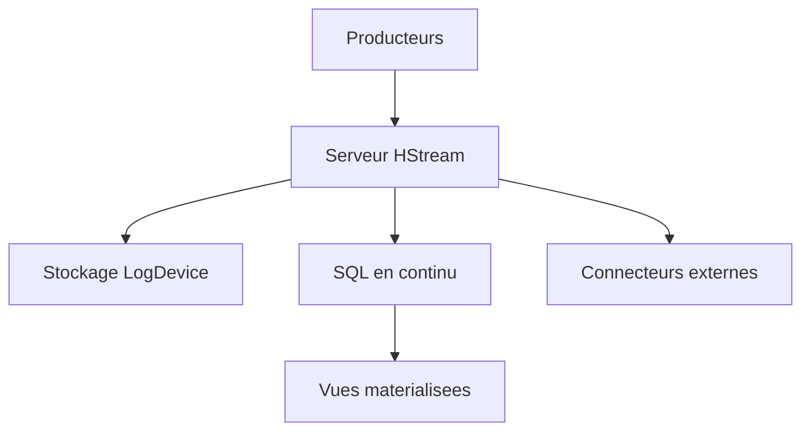

# hstreamdb/hstream

> Cloud-native streaming database with SQL, for real-time applications and IoT.

## The problem
Wiring together a message broker, a stream processing engine and a real-time query database means assembling three systems.

## What it actually does
Receives data streams and pushes them to subscribers. Allows SQL processing with time windows and joins, and incremental materialized views. Offers connectors (MQTT, MySQL, Redis, ElasticSearch). Storage is built on LogDevice.

## How it is wired

Simplified diagram based on the sheet, no diagram provided.

## Trying it
```bash
git clone --recursive git@github.com:hstreamdb/hstream.git
cd hstream/
script/dev-tools update-images
script/dev-tools start-services
script/dev-tools shell
```

## Cost and gotchas
Docker and python3 required to build. The code is in Haskell. Last push in December 2024: more than a year without activity.

## What it is not
Not a machine learning tool. The installation quickstart is not detailed in the README, which points to the website.

## Alternatives
No alternative cited in the README.

## For you
Ignore: project inactive for almost two years, and SQL streaming is better served by more active projects.
