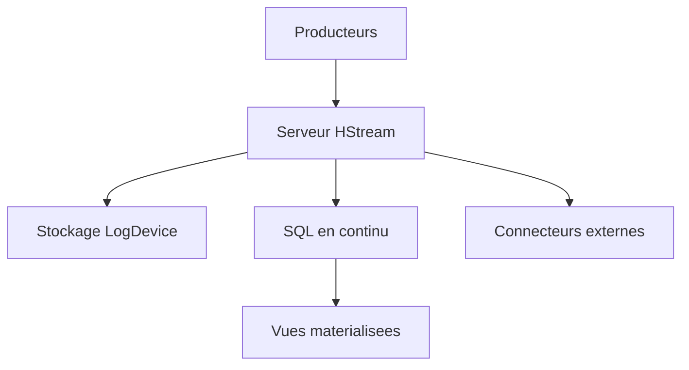

# hstreamdb/hstream

> Base de données de streaming cloud-native avec SQL, pour applications temps réel et IoT.

## Le problème
Brancher un courtier de messages, un moteur de traitement de flux et une base de requêtes en temps réel demande trois systèmes à assembler.

## Ce que ça fait vraiment
Reçoit des flux de données et les pousse aux abonnés. Permet du traitement par SQL avec fenêtres temporelles et jointures, et des vues matérialisées incrémentales. Propose des connecteurs (MQTT, MySQL, Redis, ElasticSearch). Stockage appuyé sur LogDevice.

## Comment c'est branché

Schéma simplifié d'après la fiche, sans diagramme fourni.

## Essayer
```bash
git clone --recursive git@github.com:hstreamdb/hstream.git
cd hstream/
script/dev-tools update-images
script/dev-tools start-services
script/dev-tools shell
```

## Coût et pièges
Docker et python3 requis pour construire. Le code est en Haskell. Dernier push en décembre 2024 : plus d'un an sans activité.

## Ce que ce n'est pas
Pas un outil de machine learning. Le quickstart d'installation n'est pas détaillé dans le README, il renvoie au site.

## Alternatives
Aucune alternative citée dans le README.

## Pour toi
À ignorer : projet inactif depuis près de deux ans, et le streaming SQL est mieux servi par des projets plus actifs.

