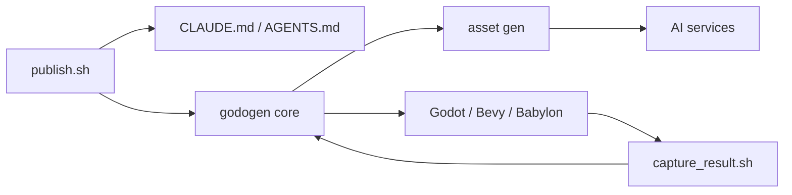

# htdt/godogen

> Game repository generator where a Claude Code/Codex agent builds a Godot, Bevy or Babylon game.

## The problem
Getting an agent to produce a playable game often fails: it compiles but the rendering is broken.

## What it actually does
`publish.sh` renders a minimal game repository (manifest, engine guide, asset skill) for a given engine and host agent.
The agent rebuilds the scaffolding, generates assets via Gemini, xAI Grok and Tripo3D, runs the engine and captures images/video.
It judges the result on the captures, not on compilation, and iterates.
Output: a live URL (Babylon) or a 15–20 s proof video.

## How it is wired


## Trying it
```bash
./publish.sh --engine godot   --agent claude --out ~/my-game
./publish.sh --engine babylon --agent codex  --out ~/my-game
./publish.sh --engine bevy    --agent claude --out ~/my-game
```

## Cost and gotchas
Three API keys (Google, xAI, Tripo3D) plus Claude Code or Codex; runs of several hours, GPU recommended.
Many system packages (vulkan, xvfb, ffmpeg, imagemagick).

## What it is not
Not a game or an engine: an instruction generator for an agent.
Not tested on Windows according to the README.

## Alternatives
No alternative named in the README.

## For you
Ignore: outside the data/MLOps domain; only the idea of an evaluation loop based on captures is transposable.
