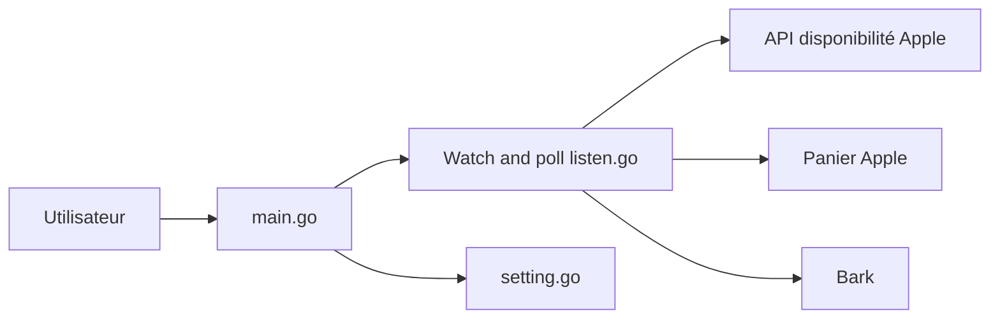

# hteen/apple-store-helper

> Desktop application that monitors iPhone availability in Apple stores and sends alerts.

## The problem
In-store pickup slots for a new iPhone go fast; refreshing the page by hand is tedious.

## What it actually does
Fyne (Go) interface: you pick a region, a store and a model, add it to a watch list and start listening. At the first stock detected, the app pauses, opens the Apple cart and notifies locally and, optionally, via Bark on iOS. It is not automated: store selection is manual.

## How it is wired


## Trying it
```bash
go run main.go
./build.sh
```

## Cost and gotchas
Free. You must be logged in to the Apple site and have put the model in the cart beforehand. The author warns that the code is not polished. README in Chinese.

## What it is not
Not a "bot" that books on its own. Outside the data/AI scope.

## Alternatives
No alternative mentioned in the README.

## For you
Ignore: a consumer tool unrelated to data, AI or MLOps, copyleft and with no activity since September 2025.
