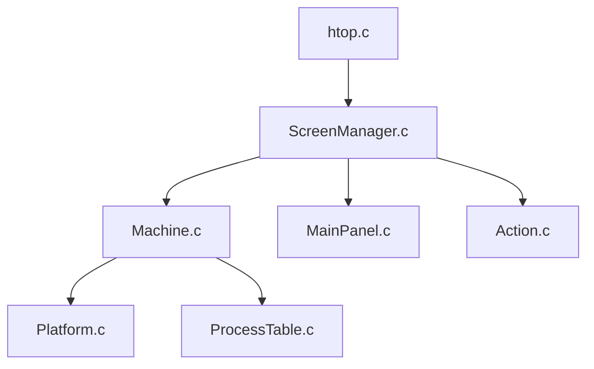

# htop-dev/htop

> Interactive, cross-platform terminal process monitor for system administrators and engineers.

## The problem
Knowing which process is using CPU or memory, and acting on it, without retyping PIDs in several commands.

## What it actually does
Shows the process list with vertical and horizontal scrolling, full command lines, load, swap and memory. Search, filter, tree view and sorting are interactive. You can kill a process or change its priority by selecting it. Settings are set through a menu, with configurable meters and an optional PCP mode.

## How it is wired


## Trying it
```bash
sudo apt install libncursesw5-dev autotools-dev autoconf automake build-essential
./autogen.sh && ./configure && make
make install
```

## Cost and gotchas
Free. Building requires autotools, a C99 compiler and ncurses 6; most distributions ship a ready-made package. I/O counters require a kernel with `CONFIG_TASK_IO_ACCOUNTING=Y`.

## What it is not
It is not a long-term monitoring tool: it shows the present moment, with no history or alerts. It cannot see GPUs.

## Alternatives
No alternative named in the README.

## For you
Adopt: a safe, well-known tool for tracking CPU and RAM on training servers or containers, with no installation cost.
