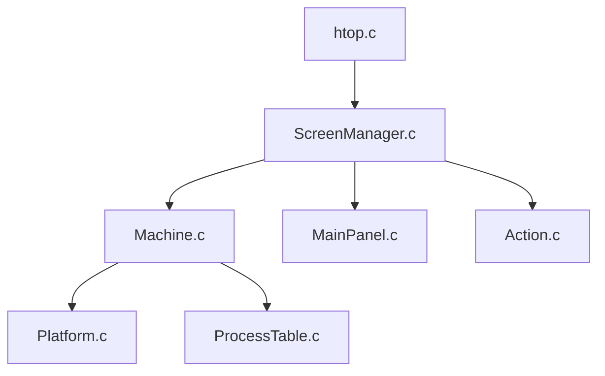

# htop-dev/htop

> Moniteur de processus interactif en terminal, multiplateforme, pour administrateurs et ingénieurs système.

## Le problème
Savoir quel processus consomme CPU ou mémoire, et agir dessus, sans retaper des PID dans plusieurs commandes.

## Ce que ça fait vraiment
Affiche la liste des processus avec défilement vertical et horizontal, les lignes de commande complètes, la charge, le swap, la mémoire. Recherche, filtre, vue en arbre et tri interactifs. On peut tuer ou changer la priorité d'un processus en le sélectionnant. Réglages par menu, compteurs configurables, mode PCP optionnel.

## Comment c'est branché


## Essayer
```bash
sudo apt install libncursesw5-dev autotools-dev autoconf automake build-essential
./autogen.sh && ./configure && make
make install
```

## Coût et pièges
Gratuit. Compiler demande autotools, un compilateur C99 et ncurses 6 ; la plupart des distributions fournissent un paquet prêt. Les compteurs d'E/S exigent un noyau avec `CONFIG_TASK_IO_ACCOUNTING=Y`.

## Ce que ce n'est pas
Ce n'est pas un outil de surveillance sur la durée : il montre l'instant présent, sans historique ni alertes. Il ne voit pas les GPU.

## Alternatives
Aucune alternative nommée dans le README.

## Pour toi
À adopter : un outil sûr et connu pour suivre CPU et RAM sur serveurs d'entraînement ou conteneurs, sans coût d'installation.

