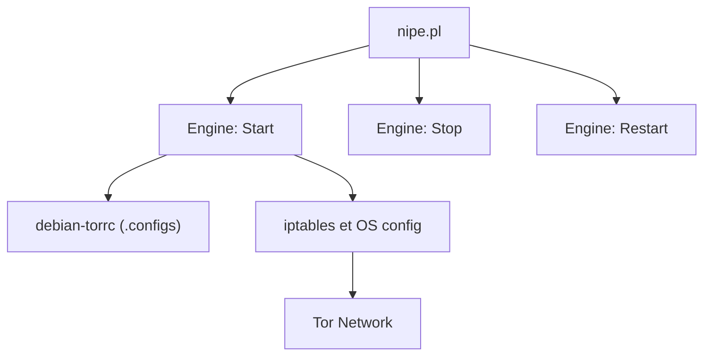

# htrgouvea/nipe

> Perl script that forces all of a Linux machine's traffic through the Tor network.

## The problem
Configuring Tor as the default gateway, with the right iptables rules, is tedious and easy to get wrong.

## What it actually does
Nipe is a Perl command (nipe.pl) that starts, stops, restarts or queries full routing through Tor. It applies iptables and ip6tables rules for IPv4 and IPv6, and loads a torrc adapted to the distribution (Arch, CentOS, Debian, Fedora, openSUSE, Void). Only local traffic is excluded. On stop, all rules are removed, including the ones that existed before.

## How it is wired


## Trying it
```bash
git clone https://github.com/htrgouvea/nipe && cd nipe
cpanm --installdeps .
perl nipe.pl install
perl nipe.pl start
perl nipe.pl status
perl nipe.pl stop
```

## Cost and gotchas
Free; must run as root and modifies the machine's firewall. The real requirement is Perl and cpanm, missing from the list. On stop, existing iptables rules are erased.

## What it is not
It is not a guarantee of anonymity: only routing is handled. It is not an attack tool, but it rewrites the firewall without distinguishing your rules from its own.

## Alternatives
No alternative named in the README (a Docker version is offered).

## For you
Worth watching: handy to test Tor routing in a disposable container, but too intrusive on the firewall for a normal work machine.
