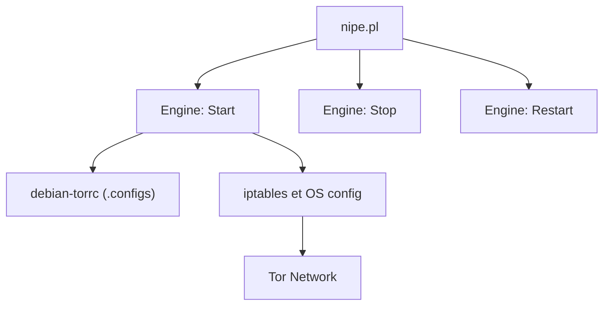

# htrgouvea/nipe

> Script Perl qui force tout le trafic d'une machine Linux à passer par le réseau Tor.

## Le problème
Configurer Tor comme passerelle par défaut, avec les bonnes règles iptables, est fastidieux et facile à rater.

## Ce que ça fait vraiment
Nipe est une commande Perl (nipe.pl) qui démarre, arrête, relance ou interroge un routage complet via Tor. Elle applique des règles iptables et ip6tables pour IPv4 et IPv6, et charge un torrc adapté à la distribution (Arch, CentOS, Debian, Fedora, openSUSE, Void). Seul le trafic local est exclu. À l'arrêt, toutes les règles sont retirées, y compris celles d'avant.

## Comment c'est branché


## Essayer
```bash
git clone https://github.com/htrgouvea/nipe && cd nipe
cpanm --installdeps .
perl nipe.pl install
perl nipe.pl start
perl nipe.pl status
perl nipe.pl stop
```

## Coût et pièges
Gratuit ; doit tourner en root et modifie le pare-feu de la machine. Le besoin réel est Perl et cpanm, absents de la liste. Au stop, les règles iptables existantes sont effacées.

## Ce que ce n'est pas
Ce n'est pas une garantie d'anonymat : seul le routage est géré. Ce n'est pas un outil d'attaque, mais il réécrit le pare-feu sans distinguer vos règles des siennes.

## Alternatives
Aucune alternative nommée dans le README (une version Docker est proposée).

## Pour toi
À surveiller : pratique pour tester un routage Tor dans un conteneur jetable, mais trop intrusif sur le pare-feu pour une machine de travail normale.

