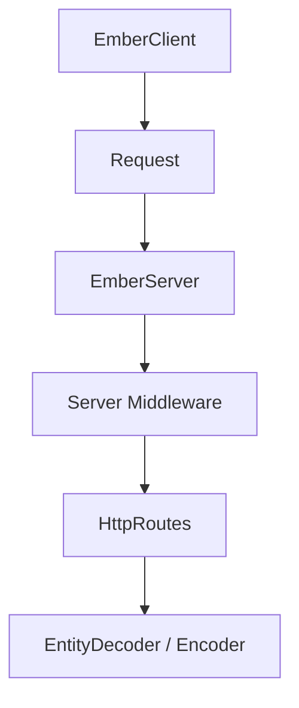

# http4s/http4s

> Minimal, idiomatic Scala interface for HTTP services, the equivalent of Rack, WSGI or Servlets.

## The problem
Writing HTTP servers and clients in functional Scala requires a typed, composable abstraction.

## What it actually does
Provides `HttpRoutes`, typed requests and responses, `EntityEncoder`/`EntityDecoder`, server and client middlewares, Ember server and client, WebSocket, multipart, static content, Circe codecs and the Jawn parser, and relies on Cats Effect and fs2 according to the diagram. The blaze backend requires a JDK ≥ 8u252.

## How it is wired


## Trying it
```bash
scalacOptions ++= Seq("-Ypartial-unification")
```
(useful outside Scala 2.13, according to the README.)

## Cost and gotchas
Free. Functional Scala ecosystem: steep learning curve. 384 open issues.

## What it is not
Not an "all-inclusive" full web framework: a minimal HTTP interface.

## Alternatives
No alternative named in the README.

## For you
Ignore, unless your data stack is in Scala (Spark) and you write HTTP services in it.
