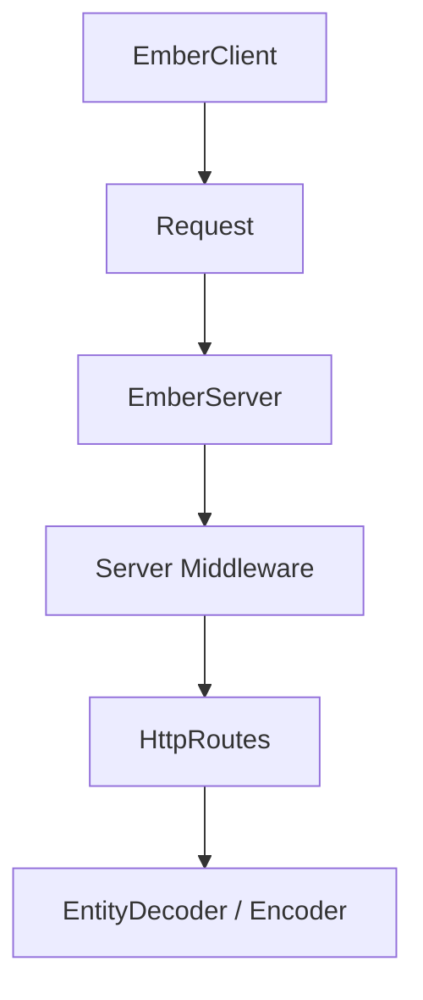

# http4s/http4s

> Interface Scala minimale et idiomatique pour services HTTP, équivalent de Rack, WSGI ou Servlets.

## Le problème
Écrire des serveurs et clients HTTP en Scala fonctionnel demande une abstraction typée et composable.

## Ce que ça fait vraiment
Fournit `HttpRoutes`, requêtes et réponses typées, `EntityEncoder`/`EntityDecoder`, middlewares serveur et client, serveur et client Ember, WebSocket, multipart, contenu statique, codecs Circe et analyseur Jawn, et s'appuie sur Cats Effect et fs2 d'après le diagramme. Le backend blaze demande un JDK ≥ 8u252.

## Comment c'est branché


## Essayer
```bash
scalacOptions ++= Seq("-Ypartial-unification")
```
(utile hors Scala 2.13, d'après le README.)

## Coût et pièges
Gratuit. Écosystème Scala fonctionnel : courbe d'apprentissage importante. 384 issues ouvertes.

## Ce que ce n'est pas
Pas un framework web complet « tout compris » : une interface HTTP minimale.

## Alternatives
Aucune alternative nommée dans le README.

## Pour toi
À ignorer, sauf si ton stack de données est en Scala (Spark) et que tu y écris des services HTTP.

