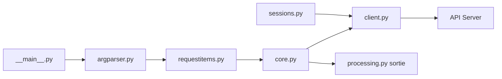

# httpie/cli

> Command-line HTTP client with readable syntax, for testing and debugging APIs.

## The problem
curl is powerful but its syntax and raw output slow down API exploration.

## What it actually does
`http` and `https` commands: `key=value` syntax for JSON, `Name:value` headers, colorized and formatted output, forms and file uploads, persistent sessions, authentication, proxies, wget-style download, `--offline` mode to build a request without sending it. A separate manager handles plugins and sessions.

## How it is wired


## Trying it
```bash
https httpie.io/hello
http PUT pie.dev/put X-API-Token:123 name=John
http --offline pie.dev/post hello=offline
```

## Cost and gotchas
Free. Installation is referred to the external documentation. Last push in December 2024.

## What it is not
Not a load-testing tool nor a graphical client (the desktop app is a separate product).

## Alternatives
None named in the README.

## For you
Adopt it for day-to-day testing of your model endpoints.
