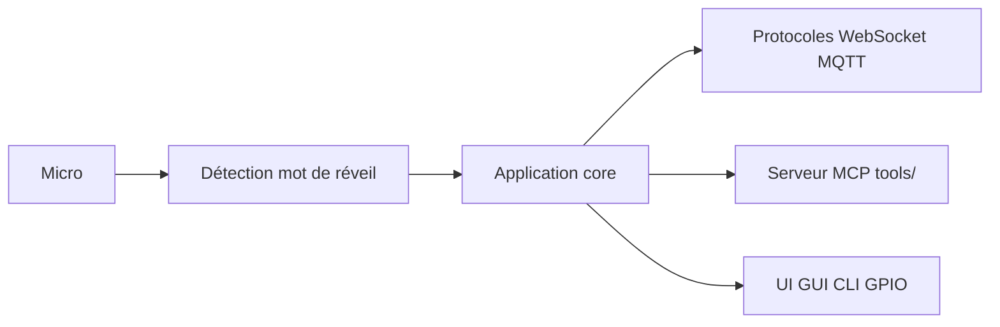

# huangjunsen0406/py-xiaozhi

> Python voice and vision client for the Xiaozhi ecosystem, from the desktop to ARM boards.

## The problem
Making an LLM converse with voice, a camera and hardware (GPIO) on a workstation or an embedded board.

## What it actually does
Asynchronous application (Python 3.10 to 3.12): Opus audio capture, offline wake word (Sherpa-ONNX), transmission over WebSocket or MQTT, IDLE/CONNECTING/LISTENING/SPEAKING state machine. An MCP tool server exposes a music player, camera, screen capture, weather and volume. Three interfaces: GUI (PySide6/QML), CLI and GPIO. The code is organized as plugins with dependency injection.

## How it is wired


## Trying it
```bash
git clone https://github.com/huangjunsen0406/py-xiaozhi.git
cd py-xiaozhi
uv sync
python main.py --mode cli
python main.py --protocol mqtt
```

## Cost and gotchas
Microphone, speakers and a stable connection required; 4 GB of RAM minimum (8 recommended); wake-word models to download. You must connect to a Xiaozhi AI service: the README does not detail which one or its cost. Reinstall the dependencies after each update.

## What it is not
Not an autonomous assistant: it depends on a remote server for the intelligence. The detailed documentation is in Chinese; the generated architecture mentions folders (`iot`, `display`) absent from the README's tree.

## Alternatives
No alternative is cited in the README (xiaozhi-esp32 and xiaozhi-desktop appear there as related projects).

## For you
Ignore: limited interest outside the Xiaozhi ecosystem, opaque remote service, a single maintainer.
