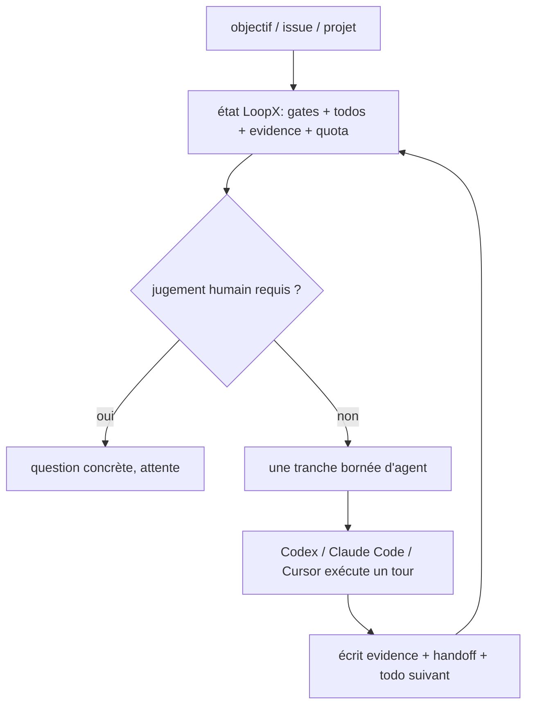

# huangruiteng/loopx

> Local control plane that keeps an agent's goals, gates and evidence across several days.

## The problem
An agent finishes a task within a session; over several days, the goal shifts, evidence goes stale and a scheduler keeps spending with no useful transition.
Chat memory and a timer are not enough to govern that.

## What it actually does
It keeps durable state outside the agent: goal, gates, todos, scope, evidence, quota — and decides whether the next turn should deliver, ask, wait or stay silent.
`loopx quota should-run`, `todo claim`, `todo update`, `refresh-state`, `quota spend-slot` form the elementary tick; execution stays with the harness (Codex, Claude Code, Cursor, shell).
A local-first workspace (`loopx dashboard`) shows what is waiting on a human, what is running, what is watched or stopped, with evidence and periodic reports.
Capabilities package work lanes: `issue-fix`, `change-quality`, `explore`, `periodic-report`, each with a declared write boundary and validation.

## How it is wired


## Trying it
```bash
python3 -m pip install --upgrade loopx
loopx workflow-skills --install
loopx doctor
cd /path/to/your-project
loopx connect
loopx status
```

## Cost and gotchas
Python 3.11+ and Node.js 22.18+ (24 LTS recommended); the TypeScript core starts on its own. Models remain at your expense through your harness.
The README insists: it is not an autonomous production controller — dangerous permissions, publishing and production writes remain human.

## What it is not
It is neither an agent framework nor a vendor-tied orchestration runtime: it sits on top of what you already have.
The "200+ hours" and the benchmarks (SWE-Marathon, LHTB) are one-off trials per task, presented by the author as establishing no general gain — and several cases are unreproduced user reports.

## Alternatives
No competing project is named in the README; it cites OpenViking as a reward-memory option, not as an alternative.

## For you
The vocabulary (gates, quota, evidence) fits long-running loops; wait for reproduced cases before making it your scheduler.
