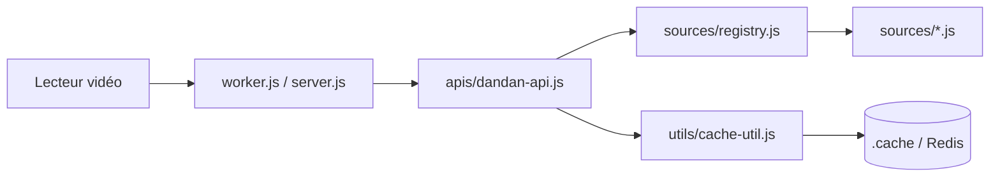

# huangxd-/danmu_api

> Self-hosted JS server that serves "danmu" comments from Chinese video platforms to compatible players.

## The problem
Video players (senplayer, Forward, FongMi…) expect a scrolling-comments API in the dandanplay format. Without an intermediary server, you have to fetch them platform by platform.

## What it actually does
- Exposes a dandanplay-compatible API (`/api/v2/search/anime`, `/match`, `/comment`) and aggregates about twenty sources (Tencent, iQiyi, Bilibili, Bahamut, etc.).
- Converts, filters (blocked words, time offset, deduplication) and outputs Bilibili JSON or XML.
- In-memory cache, persistent favorites (file or Redis), import of local comment files, optional LLM-based matching (`AI_API_KEY`).
- Web administration interface: logs, API tests, settings.

## How it is wired


## Trying it
```bash
docker pull logvar/danmu-api:latest
docker run -d -p 9321:9321 --name danmu-api -e TOKEN=87654321 logvar/danmu-api:latest
# puis : GET http://{ip}:9321/87654321/api/v2/search/anime?keyword=生万物
```
Or locally: `git clone`, `npm install`, `npm start` (Node ≥ 18).

## Cost and gotchas
Free; Docker or Node is enough, or serverless deployment (Vercel, Cloudflare, Netlify…). The default token `87654321` is public: change it. Bilibili/Douban cookies, TMDB key or LLM key are optional and at your expense. Default limit: 3 requests/minute/IP on `/comment`.

## What it is not
Not a player nor a content host: it relays data from third-party services, whose terms of use and copyright remain to be checked according to your jurisdiction (the author describes a study project and asks not to promote it on Chinese media). Depends on sites that can change without notice; Netlify is flagged by the README as risky for this kind of use. README and interface in Chinese.

## Alternatives
- danmaku-anywhere: provides the open dandanplay API this project depends on.
- animeko: a comment source the project already integrates.
- danmu-api-android (@lilixu3): Android port of the same server.

## For you
Unrelated to data/AI/MLOps work, except out of curiosity about API aggregation or LLM matching: only worth watching, since it is a single-maintainer project, under AGPL-3.0, relying on fragile scrapers.
