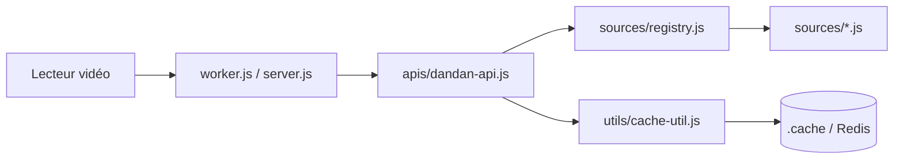

# huangxd-/danmu_api

> Serveur JS auto-hébergé qui sert des commentaires « danmu » de plateformes vidéo chinoises à des lecteurs compatibles.

## Le problème
Les lecteurs vidéo (senplayer, Forward, FongMi…) attendent une API de commentaires défilants au format dandanplay. Sans serveur intermédiaire, il faut les récupérer plateforme par plateforme.

## Ce que ça fait vraiment
- Expose une API compatible dandanplay (`/api/v2/search/anime`, `/match`, `/comment`) et agrège une vingtaine de sources (Tencent, iQiyi, Bilibili, Bahamut, etc.).
- Convertit, filtre (mots bloqués, décalage temporel, dédoublonnage) et sort en JSON ou XML Bilibili.
- Cache en mémoire, favoris persistants (fichier ou Redis), import de fichiers de commentaires locaux, appariement optionnel par LLM (`AI_API_KEY`).
- Interface web d'administration : logs, tests d'API, réglages.

## Comment c'est branché


## Essayer
```bash
docker pull logvar/danmu-api:latest
docker run -d -p 9321:9321 --name danmu-api -e TOKEN=87654321 logvar/danmu-api:latest
# puis : GET http://{ip}:9321/87654321/api/v2/search/anime?keyword=生万物
```
Ou en local : `git clone`, `npm install`, `npm start` (Node ≥ 18).

## Coût et pièges
Gratuit ; Docker ou Node suffit, ou déploiement serverless (Vercel, Cloudflare, Netlify…). Le token par défaut `87654321` est public : à changer. Cookies Bilibili/Douban, clé TMDB ou LLM facultatifs, à ta charge. Limite par défaut : 3 requêtes/minute/IP sur `/comment`.

## Ce que ce n'est pas
Pas un lecteur ni un hébergeur de contenu : il relaie des données de services tiers, dont les conditions d'usage et le droit d'auteur restent à vérifier selon ta juridiction (l'auteur parle d'un projet d'étude et demande de ne pas le promouvoir sur les médias chinois). Dépend de sites qui peuvent changer sans prévenir ; Netlify signalé par le README comme risqué pour ce type d'usage. README et interface en chinois.

## Alternatives
- danmaku-anywhere : fournit l'API ouverte dandanplay dont ce projet dépend.
- animeko : source de commentaires que le projet intègre déjà.
- danmu-api-android (@lilixu3) : portage Android du même serveur.

## Pour toi
Sans rapport avec un travail data/IA/MLOps, sauf curiosité sur l'agrégation d'API ou l'appariement LLM : à surveiller seulement, car c'est un projet d'un seul mainteneur, sous AGPL-3.0, dépendant de scrapers fragiles.

