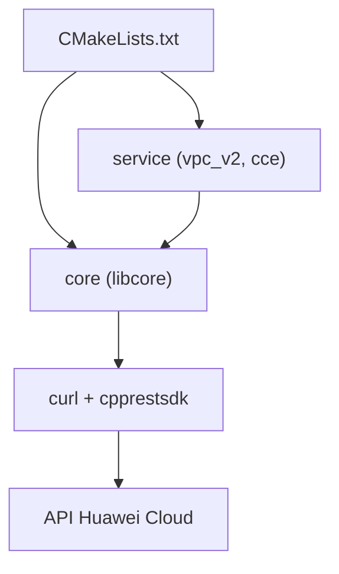

# huaweicloud/huaweicloud-sdk-cpp-v3

> C++ SDK generated to call Huawei Cloud services (ECS, VPC, CCE) from a native application.

## The problem
Calling Huawei Cloud APIs from C++ means handling signing, authentication and request models.

## What it actually does
The SDK is generated by an internal team with openapi-generator. Each service is compiled separately with CMake (`-DBUILD_SERVICE=cce`). It handles permanent or temporary AK/SK credentials, regions, proxy, timeouts, asynchronous clients and logs. It depends on curl, boost, cpprestsdk, spdlog, openssl and rttr.

## How it is wired
Simplified diagram based on the sheet, no diagram provided.


## Trying it
```bash
mkdir build && cd build
cmake -DBUILD_SERVICE=cce -DSERVICE_VERSION=v3 ..
make
sudo make install
```

## Cost and gotchas
A Huawei Cloud account, AK/SK keys and activated services. C++14, CMake 3.10 and several third-party libraries. The README is truncated before the end. License not declared; contributions are not accepted.

## What it is not
Not a community open-source SDK: the code is generated and published by Huawei.

## Alternatives
No alternative named in the README.

## For you
Ignore: a C++ SDK for one specific cloud, of no direct interest to a data, AI or MLOps profile outside Huawei Cloud.
