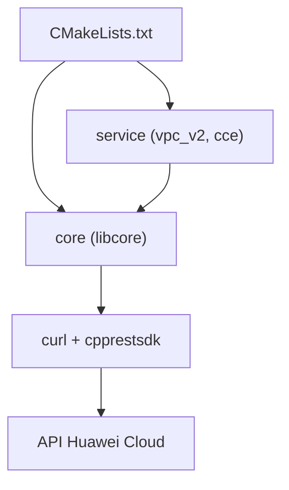

# huaweicloud/huaweicloud-sdk-cpp-v3

> SDK C++ généré pour appeler les services Huawei Cloud (ECS, VPC, CCE) depuis une application native.

## Le problème
Appeler les API de Huawei Cloud depuis du C++ demande de gérer signature, authentification et modèles de requêtes.

## Ce que ça fait vraiment
Le SDK est généré par une équipe interne avec openapi-generator. Chaque service se compile séparément avec CMake (`-DBUILD_SERVICE=cce`). Il gère les identifiants permanents ou temporaires AK/SK, les régions, le proxy, les délais, les clients asynchrones et les journaux. Il dépend de curl, boost, cpprestsdk, spdlog, openssl et rttr.

## Comment c'est branché
Schéma simplifié d'après la fiche, sans diagramme fourni.


## Essayer
```bash
mkdir build && cd build
cmake -DBUILD_SERVICE=cce -DSERVICE_VERSION=v3 ..
make
sudo make install
```

## Coût et pièges
Compte Huawei Cloud, clés AK/SK et services activés. C++14, CMake 3.10 et plusieurs bibliothèques tierces. Le README est tronqué avant la fin. Licence non déclarée ; les contributions ne sont pas acceptées.

## Ce que ce n'est pas
Pas un SDK open source communautaire : le code est généré et publié par Huawei.

## Alternatives
Aucune alternative nommée dans le README.

## Pour toi
À ignorer : SDK C++ pour un cloud précis, sans intérêt direct pour un profil data, IA ou MLOps hors Huawei Cloud.

