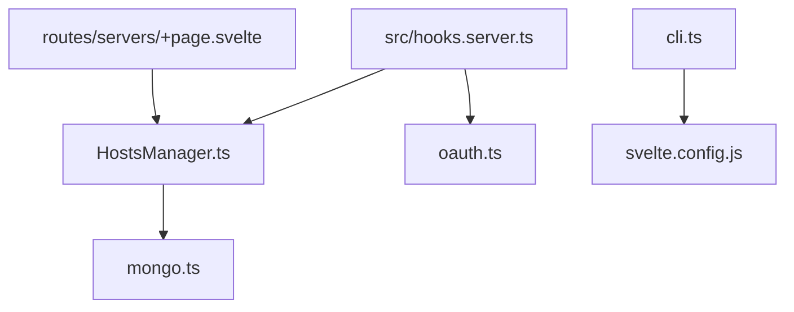

# huggingface/Mongoku

> Self-hosted web client for MongoDB, to query your data from a browser.

## The problem
Exploring a MongoDB database requires a heavy client or hand-written queries, which are hard to share across a team.

## What it actually does
A SvelteKit interface served by Node.js that opens MongoDB connections on the server side, with sorting, skip and limit. It offers a read-only mode, basic authentication or OAuth2 PKCE, structured logs and mappings between documents. Hugging Face says it uses it on a cluster of more than one terabyte.

## How it is wired


## Trying it
```bash
npm install -g mongoku
mongoku
mongoku --readonly
docker run -d --name mongoku -p 3100:3100 huggingface/mongoku
```

## Cost and gotchas
Free. Docker is optional (npm is enough). Use the `compat` tag for MongoDB before 4.2 or DocumentDB before 5.0. Protect access with auth and read-only mode before exposing it.

## What it is not
Not a cluster administration or backup tool: a query explorer.

## Alternatives
No alternative named in the README.

## For you
Adopt: a lightweight web MongoDB client, maintained by Hugging Face, useful for inspecting datasets or pipeline databases.
