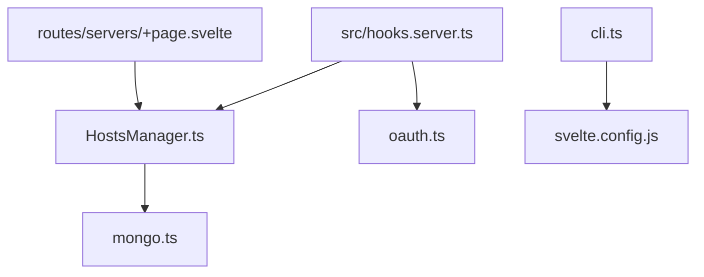

# huggingface/Mongoku

> Client web pour MongoDB à héberger soi-même, pour interroger ses données depuis un navigateur.

## Le problème
Explorer une base MongoDB demande un client lourd ou des requêtes à la main, difficiles à partager en équipe.

## Ce que ça fait vraiment
Une interface SvelteKit servie par Node.js qui ouvre les connexions MongoDB côté serveur, avec tri, saut et limite. Elle propose un mode lecture seule, une authentification basique ou OAuth2 PKCE, des journaux structurés et des mappings entre documents. Hugging Face dit l'utiliser sur un cluster de plus d'un téraoctet.

## Comment c'est branché


## Essayer
```bash
npm install -g mongoku
mongoku
mongoku --readonly
docker run -d --name mongoku -p 3100:3100 huggingface/mongoku
```

## Coût et pièges
Gratuit. Docker est optionnel (npm suffit). Utiliser le tag `compat` pour MongoDB avant 4.2 ou DocumentDB avant 5.0. Protéger l'accès par auth et mode lecture seule avant exposition.

## Ce que ce n'est pas
Pas un outil d'administration de cluster ni de sauvegarde : un explorateur de requêtes.

## Alternatives
Aucune alternative nommée dans le README.

## Pour toi
Adopter : un client MongoDB web léger, maintenu par Hugging Face, utile pour inspecter des jeux de données ou des bases de pipelines.

