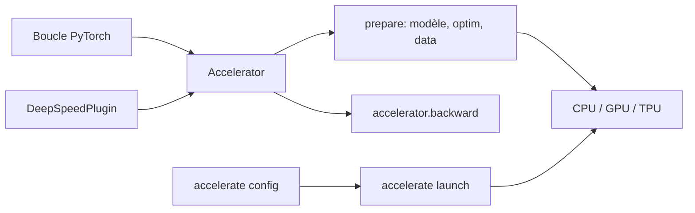

# huggingface/accelerate

> Five lines added to a PyTorch loop to make it run on multi-GPU, TPU or fp16.

## The problem
Moving a PyTorch training loop from CPU to multi-GPU, TPU or mixed precision requires plumbing code that you have to write, maintain, and strip out to debug locally.

## What it actually does
It abstracts exactly and only that plumbing. You instantiate an `Accelerator`, pass the model, optimizer and dataloader to `accelerator.prepare(...)`, and replace `loss.backward()` with `accelerator.backward(loss)`: the same file runs on CPU only, one GPU, several GPUs or TPU, with or without fp8/fp16/bf16. By delegating tensor placement, the `.to(device)` calls disappear too.
An optional CLI (`accelerate config`, `accelerate launch`) replaces `torch.distributed.run`.

## How it is wired


## Trying it
```bash
pip install accelerate
accelerate config
accelerate launch examples/nlp_example.py
accelerate launch --multi_gpu --num_processes 2 examples/nlp_example.py
mpirun -np 2 python examples/nlp_example.py
```

## Cost and gotchas
Free, Apache 2.0 (README header). Tested on Python 3.8+ and PyTorch 1.10+. Multi-CPU via MPI assumes Open MPI, Intel MPI or MVAPICH installed on the cluster. DeepSpeed support is announced as **experimental**. The real cost remains that of the GPUs.

## What it is not
Not a high-level framework: the README says so — if you don't want to write your own training loop, this is not the tool. Not a cluster orchestrator either. The whole API fits in one class, which is a strength but limits what you can expect from it.

## Alternatives
- **fastai**: `Learner` that handles the whole loop, built on top of Accelerate.
- **Catalyst**: `Runner` linking hardware, data and training.
- **pytorch-accelerated**: minimalist `Trainer`, same philosophy of transparency.

## For you
Install by default: near-zero adoption cost, and the exit door to multi-GPU stays open.
