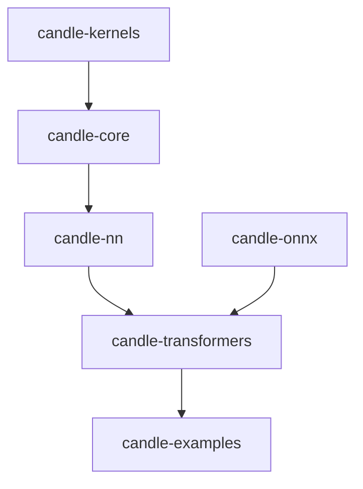

# huggingface/candle

> Minimalist machine learning framework in Rust, designed for lightweight inference without Python.

## The problem
PyTorch is bulky: starting serverless instances is slow and Python weighs down production.

## What it actually does
A PyTorch-like tensor API with CPU (MKL, Accelerate), CUDA and WASM backends. Crates cover neural networks, transformers, ONNX and CUDA kernels. Examples run LLaMA, Mistral, Whisper, Stable Diffusion, YOLO. It loads safetensors, npz, ggml and PyTorch files, with quantization.

## How it is wired
Diagram based on the one provided, reduced.



## Trying it
```bash
cargo run --example quantized --release
cargo run --example quantized --release --features cuda
```

## Cost and gotchas
Free, Rust toolchain required. CUDA, cuDNN or MKL are optional but often necessary. LLaMA models require a Hugging Face account and acceptance of their terms. In Docker, `CUDA_COMPUTE_CAP` must be set by hand.

## What it is not
Not a complete PyTorch replacement: training exists, but the stated goal is serverless inference. No GPU required for the CPU examples.

## Alternatives
- dfdx: tensor shapes in the types, but some functions require nightly.
- burn: multi-backend, for choosing the engine according to the workload.
- tch-rs: bindings to torch, very versatile but bundles all of torch.

## For you
Worth watching: interesting for deploying lightweight inference in Rust; if your stack is in Python, the gain does not justify migrating.
