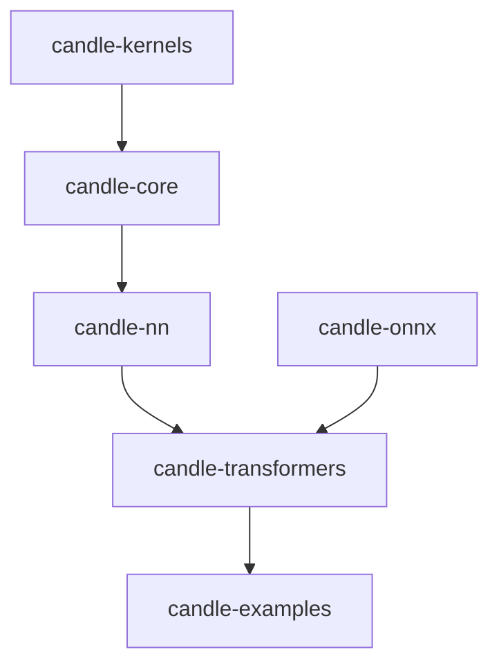

# huggingface/candle

> Framework d'apprentissage automatique minimaliste en Rust, pensé pour l'inférence légère sans Python.

## Le problème
PyTorch est volumineux : démarrer des instances serverless est lent et Python alourdit la production.

## Ce que ça fait vraiment
Une API de tenseurs à la PyTorch avec backends CPU (MKL, Accelerate), CUDA et WASM. Des crates couvrent réseaux de neurones, transformers, ONNX et noyaux CUDA. Des exemples font tourner LLaMA, Mistral, Whisper, Stable Diffusion, YOLO. Il charge safetensors, npz, ggml et fichiers PyTorch, avec quantification.

## Comment c'est branché
Schéma d'après le diagramme fourni, réduit.



## Essayer
```bash
cargo run --example quantized --release
cargo run --example quantized --release --features cuda
```

## Coût et pièges
Gratuit, chaîne Rust requise. CUDA, cuDNN ou MKL sont optionnels mais souvent nécessaires. Les modèles LLaMA demandent un compte Hugging Face et l'acceptation de leurs conditions. Dans Docker, `CUDA_COMPUTE_CAP` doit être fixé à la main.

## Ce que ce n'est pas
Pas un remplaçant complet de PyTorch : l'entraînement existe, mais l'objectif affiché est l'inférence serverless. Pas de GPU obligatoire pour les exemples CPU.

## Alternatives
- dfdx : formes de tenseurs dans les types, mais certaines fonctions exigent nightly.
- burn : multi-backends, pour choisir le moteur selon la charge.
- tch-rs : liaisons vers torch, très polyvalent mais embarque tout torch.

## Pour toi
À surveiller : intéressant pour déployer de l'inférence légère en Rust ; si ton stack est en Python, le gain ne justifie pas de migrer.

