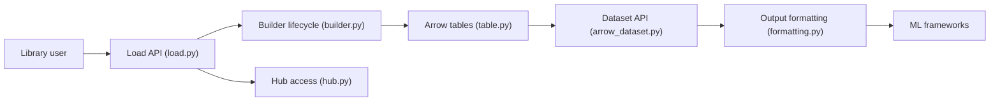

# huggingface/datasets

> Python library to load, stream and preprocess ML datasets from the Hub or locally.

## The problem
Every public dataset has its own format and download script; large volumes saturate RAM and preprocessing gets rerun needlessly.

## What it actually does
`load_dataset()` loads a dataset from the Hub or local files (CSV, JSON, Parquet, images, audio, PDF, NIfTI...).
Memory-mapped Apache Arrow storage; parallelizable `map()` with fingerprint-based caching.
`streaming=True` mode to iterate without downloading; conversion to NumPy, pandas, Polars, PyTorch, TensorFlow, JAX, Spark.
FAISS and Elasticsearch indexes; publishing to the Hub.

## How it is wired


## Trying it
```bash
pip install datasets
conda install -c huggingface -c conda-forge datasets
pip install datasets[audio]
pip install datasets[vision]
```

## Cost and gotchas
Free. The disk cache grows quickly; some Hub datasets are subject to their own access rules or licenses. Pin the `revision` for reproducibility.

## What it is not
Not a data versioning tool in the DVC sense. Does not guarantee the quality or licenses of datasets hosted on the Hub.

## Alternatives
No alternative named in the README.

## For you
Adopt: a standard building block of any training or evaluation pipeline; streaming and the Arrow cache solve most volume problems.
