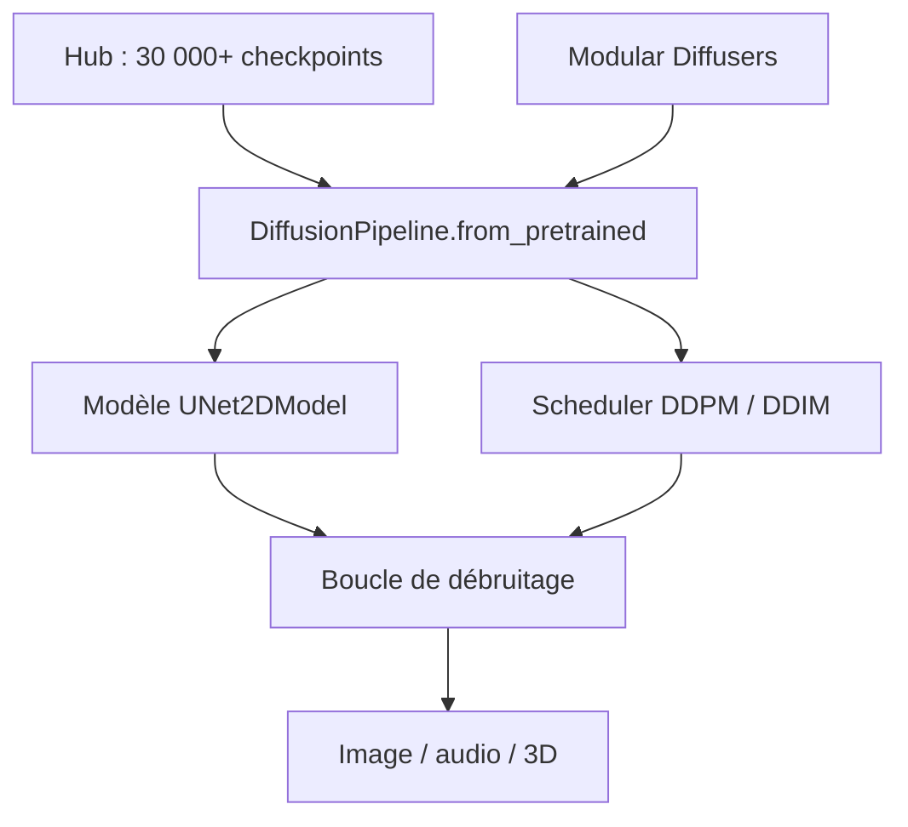

# huggingface/diffusers

> Library of pretrained diffusion models for generating images, audio and 3D structures.

## The problem
Each diffusion model comes with its own code, scheduler and weight conventions.
Going from inference to training, or changing scheduler, means rewriting the loop.

## What it actually does
Three components: diffusion pipelines runnable in a few lines, interchangeable noise schedulers, and pretrained models usable as building blocks.
`DiffusionPipeline.from_pretrained` loads any of the 30,000+ checkpoints on the Hub; you can also drop down to the `UNet2DModel` + `DDPMScheduler` level and write your own denoising loop.
Covers unconditional generation (DDPM), text→image (Stable Diffusion, unCLIP, DeepFloyd IF, Kandinsky), guided image→image (ControlNet, InstructPix2Pix), inpainting, variations, super-resolution.
The documentation is split into Quickstart, Loading, Modular Diffusers, Optimization and Training; conventions for agents are in `.ai/`.

## How it is wired


## Trying it
```bash
pip install --upgrade diffusers[torch]
```

```python
from diffusers import DiffusionPipeline
import torch
pipeline = DiffusionPipeline.from_pretrained("stable-diffusion-v1-5/stable-diffusion-v1-5", dtype=torch.float16)
pipeline.to("cuda")
pipeline("An image of a squirrel in Picasso style").images[0]
```

## Cost and gotchas
Free, but `float16` inference on `cuda` assumes a GPU; checkpoints weigh several GB to download.
The README states a priority on usability over performance: for high-throughput serving, you will need to optimize.

## What it is not
It is not an inference server: it is a library, exposing it as an API is up to you.
It is not a license guarantee on the models: each Hub checkpoint has its own.
It is not optimized by default: the Optimization guide exists precisely because tuning is not automatic.

## Alternatives
The README names no competitor: it lists libraries built on top of it (InvokeAI, BentoML, kohya_ss) and credits the original implementations (CompVis latent diffusion, ermongroup's DDIM).

## For you
The reference if you touch image generation: that is where models arrive first.
