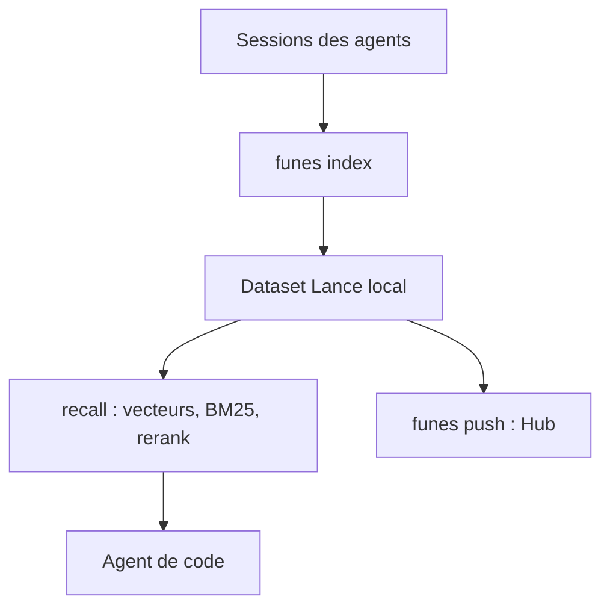

# huggingface/funes

> Durable memory for coding agents: indexes past sessions and makes them recallable.

## The problem
A coding agent forgets decisions, dead ends and reasons already found from one session to the next.

## What it actually does
`funes` indexes the sessions of Claude Code, Codex, pi and Hermes into a single local dataset (Lance). The agent then recalls via `recall` and `get`, with vector search plus BM25 and cross-encoder reranking. The memory can be published as a private dataset on the Hugging Face Hub. Credentials are masked at indexing time.

## How it is wired


## Trying it
```bash
curl -fsSL "https://huggingface.co/buckets/huggingface/funes/resolve/install.sh?src=readme" | sh
funes add claude
funes recall "why is funes append-only" --memory huggingface/funes-memory
funes ask claude "why is funes append-only" --memory huggingface/funes-memory
```

## Cost and gotchas
Free; the embedding and reranking models run locally. A Hugging Face account and token are only needed for publishing. An anonymous installation identifier is sent to the Hub (`DO_NOT_TRACK=1` turns it off).

## What it is not
Not a generative model: it does not reason, it retrieves. Its output is aimed at agents, not human reading; a published memory must stay private.

## Alternatives
No alternative named in the README (comparison deferred to docs/RATIONALE.md).

## For you
Adopt: local, shareable cross-session memory for your agents, maintained by Hugging Face, easy to try on the public dataset.
