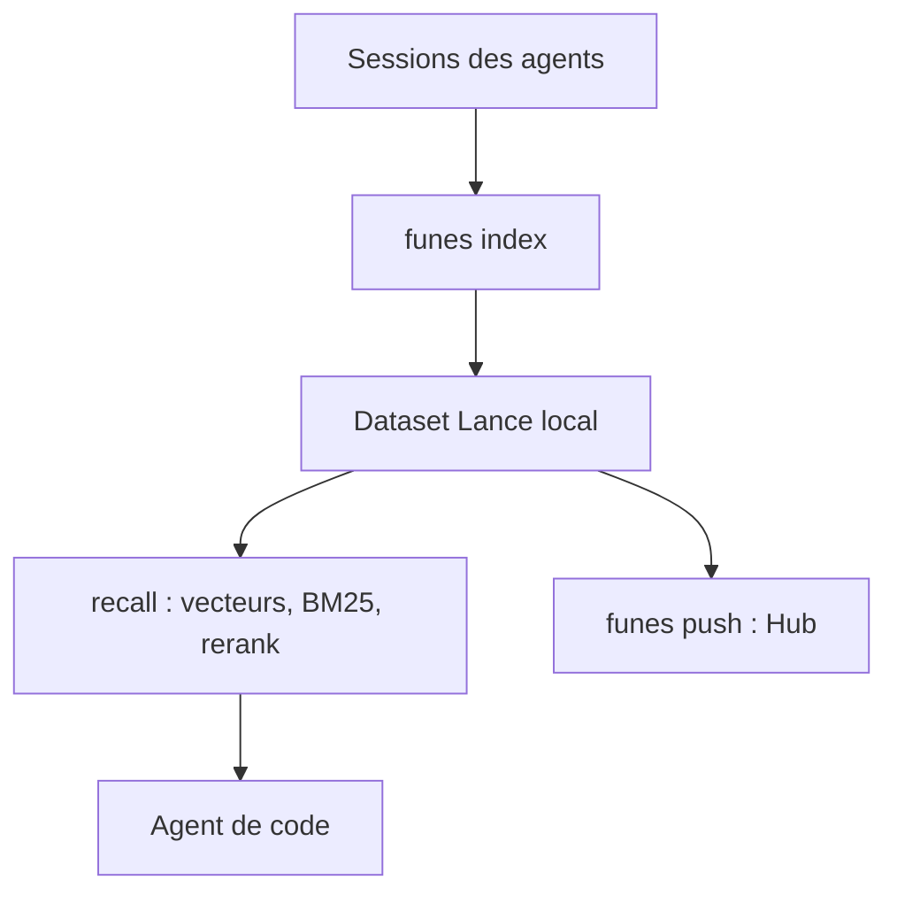

# huggingface/funes

> Mémoire durable pour agents de code : indexe les sessions passées et les rend rappelables.

## Le problème
Un agent de code oublie d'une session à l'autre les décisions, impasses et raisons déjà trouvées.

## Ce que ça fait vraiment
`funes` indexe les sessions de Claude Code, Codex, pi et Hermes dans un seul jeu de données local (Lance). L'agent rappelle ensuite via `recall` et `get`, avec recherche vectorielle plus BM25 et reranking par cross-encodeur. La mémoire peut être publiée comme dataset privé sur le Hub Hugging Face. Les identifiants sont masqués à l'indexation.

## Comment c'est branché


## Essayer
```bash
curl -fsSL "https://huggingface.co/buckets/huggingface/funes/resolve/install.sh?src=readme" | sh
funes add claude
funes recall "why is funes append-only" --memory huggingface/funes-memory
funes ask claude "why is funes append-only" --memory huggingface/funes-memory
```

## Coût et pièges
Gratuit ; les modèles d'embedding et de reranking sont locaux. Un compte et un token Hugging Face ne servent que pour publier. Un identifiant d'installation anonyme est envoyé au Hub (`DO_NOT_TRACK=1` le coupe).

## Ce que ce n'est pas
Pas un modèle génératif : il ne raisonne pas, il retrouve. Sa sortie vise les agents, pas la lecture humaine ; une mémoire publiée doit rester privée.

## Alternatives
Aucune alternative nommée dans le README (comparaison renvoyée à docs/RATIONALE.md).

## Pour toi
Adopter : mémoire inter-sessions locale et partageable pour tes agents, éditée par Hugging Face, simple à tester sur le dataset public.

