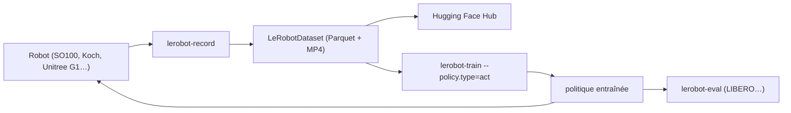

# huggingface/lerobot

> PyTorch models, datasets and tools for real-world robotics, backed by the Hub.

## The problem
Every lab reinvents its data format and hardware interface: nothing is shared.
Moving from one arm to another forces a rewrite of collection, training and evaluation.

## What it actually does
A single `Robot` class decouples control logic from hardware: `connect`, `get_observation`, `send_action`.
The `LeRobotDataset` format combines MP4 videos (or images) and Parquet for states/actions, hosted on the Hub.
Policies implemented in pure PyTorch: imitation (ACT, Diffusion, VQ-BeT), RL (HIL-SERL), VLA (Pi0, SmolVLA, GR00T N1.7), world and reward models.
`lerobot-train` and `lerobot-eval` drive training and evaluation, including on the LIBERO and MetaWorld benchmarks.

## How it is wired


## Trying it
```bash
pip install lerobot
lerobot-info
lerobot-train --policy.type=act --dataset.repo_id=lerobot/aloha_mobile_cabinet
lerobot-eval --policy.path=lerobot/pi0_libero_finetuned --env.type=libero --env.task=libero_object --eval.n_episodes=10
pip install lerobot_robot_<name> lerobot_teleoperator_<name>
```

## Cost and gotchas
GPU/RAM requirements and per-policy training times are deferred to a separate hardware guide.
Without a robot, only the simulation and datasets part is usable.

## What it is not
It is not a simulator: environments come from external benchmarks or EnvHub.
It is not plug-and-play hardware: beyond the native robots, community plugins must be installed and checked.
The listed models cover very different maturity levels (some announced as "coming soon").

## Alternatives
No alternative named in the README; only third-party hardware plugins and LeLab for a web interface.

## For you
Outside your scope unless you have a robotics project; worth keeping in mind for the multimodal dataset format, which is well designed.
