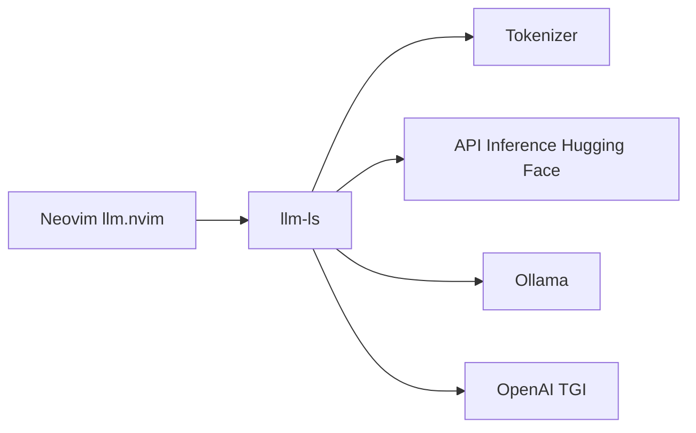

# huggingface/llm.nvim

> Neovim plugin for LLM code completion, with llm-ls as backend, for developers.

## The problem
Getting LLM code completion in Neovim, with the model of your choice and without exceeding the context window.

## What it actually does
It offers ghost text in the style of Copilot. Requests go over HTTP to the Hugging Face inference API, or to Ollama, an OpenAI-compatible API or TGI. The prompt is cut to fit the context window, thanks to tokenizers. The llm-ls language server is downloaded on first load, or installed via Mason.

## How it is wired
Simplified diagram based on the sheet, no diagram provided.


## Trying it
```lua
require("lazy").setup({
  {
    'huggingface/llm.nvim',
    opts = {
      -- cf Setup
    }
  },
})
```
Commands: `LLMToggleAutoSuggest` and `LLMSuggestion`.

## Cost and gotchas
The free Hugging Face API is rate-limited; the PRO subscription is recommended. The llm-ls binary is downloaded from the releases. The token is given as an environment variable.

## What it is not
It is not an agent or a chat, only completion. The README describes a single default model (Starcoder) and an OpenAI section copied from the Ollama one.

## Alternatives
The README cites copilot.vim and tabnine-nvim, from which it draws inspiration; it does not say why to prefer it.

## For you
Worth watching: handy if you code in Neovim and want to plug in a local model via Ollama rather than a paid service.
