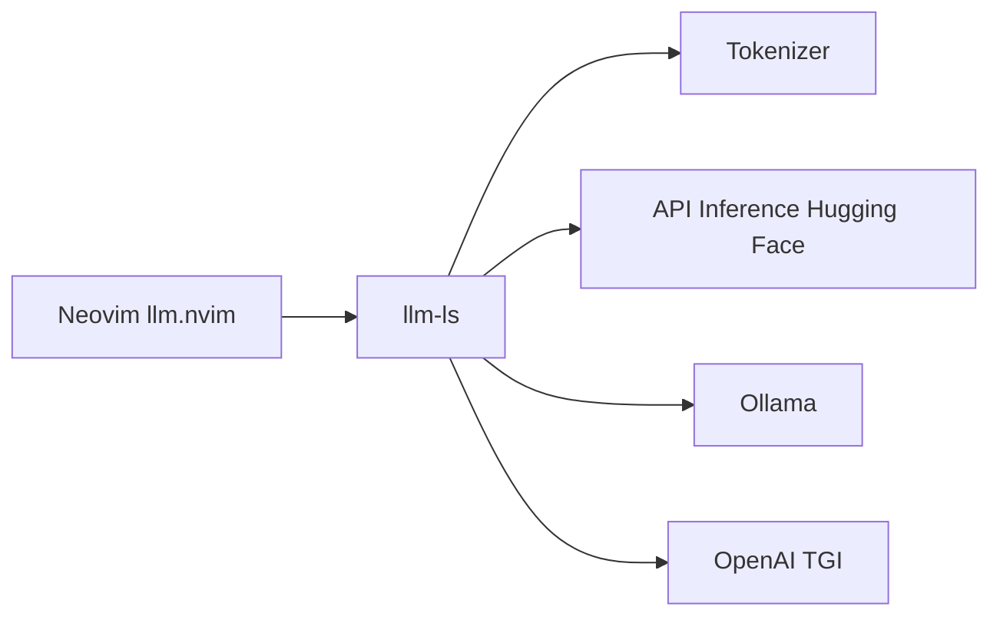

# huggingface/llm.nvim

> Plugin Neovim de complétion de code par LLM, avec llm-ls en backend, pour développeurs.

## Le problème
Obtenir une complétion de code par LLM dans Neovim, avec le modèle de ton choix et sans dépasser la fenêtre de contexte.

## Ce que ça fait vraiment
Il propose du texte fantôme à la manière de Copilot. Les requêtes partent en HTTP vers l'API d'inférence de Hugging Face, ou vers Ollama, une API compatible OpenAI ou TGI. Le prompt est découpé pour tenir dans la fenêtre de contexte, grâce aux tokenizers. Le serveur de langage llm-ls est téléchargé au premier chargement, ou installé via Mason.

## Comment c'est branché
Schéma simplifié d'après la fiche, sans diagramme fourni.


## Essayer
```lua
require("lazy").setup({
  {
    'huggingface/llm.nvim',
    opts = {
      -- cf Setup
    }
  },
})
```
Commandes : `LLMToggleAutoSuggest` et `LLMSuggestion`.

## Coût et pièges
L'API gratuite d'Hugging Face est limitée en débit ; l'abonnement PRO est conseillé. Le binaire llm-ls est téléchargé depuis les releases. Le jeton se donne en variable d'environnement.

## Ce que ce n'est pas
Ce n'est pas un agent ni un chat, seulement de la complétion. Le README décrit un seul modèle par défaut (Starcoder) et une section OpenAI copiée de celle d'Ollama.

## Alternatives
Le README cite copilot.vim et tabnine-nvim, dont il s'inspire ; il ne dit pas pourquoi les préférer.

## Pour toi
À surveiller : pratique si tu codes sous Neovim et veux brancher un modèle local via Ollama plutôt qu'un service payant.

