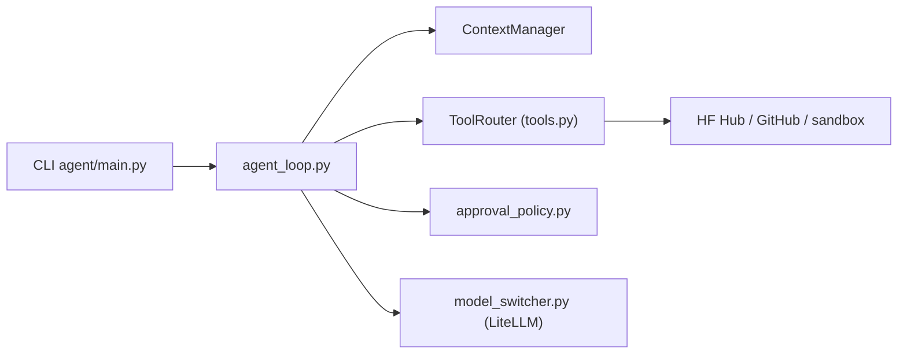

# huggingface/ml-intern

> Command-line agent, now retired, that read, wrote and ran ML code through the Hugging Face ecosystem.

## The problem
Chaining doc search, code, training jobs and publishing to the Hub takes many manual steps.

## What it actually does
An agent loop (`agent_loop.py`, 300 iterations maximum) calls an LLM through LiteLLM, runs tools (local files, GitHub, Hub, jobs, papers, HF Space sandbox, MCP servers) and compacts the context. Guardrails ask for approval on sensitive actions and detect loops. Sessions are uploaded to a private Hugging Face dataset. The web app and the CLI are retired: the repository is kept for the record.

## How it is wired


## Trying it
```bash
git clone git@github.com:huggingface/ml-intern.git
cd ml-intern
uv sync
uv tool install -e .
ml-intern
```

## Cost and gotchas
`HF_TOKEN` and `GITHUB_TOKEN` required; hosted inference is billed to the HF user. An anonymized telemetry dataset (`smolagents/ml-intern-sessions`) receives metrics rows, and trace upload can be turned off (`share_traces: false`).

## What it is not
Not a maintained project: "No support, bug fixes, or security updates". The README points to HuggingChat.

## Alternatives
HuggingChat (named by the README as the successor).

## For you
Ignore: an archived repository with no security updates, to be read only as an example of an agent architecture with approvals and loop detection.
