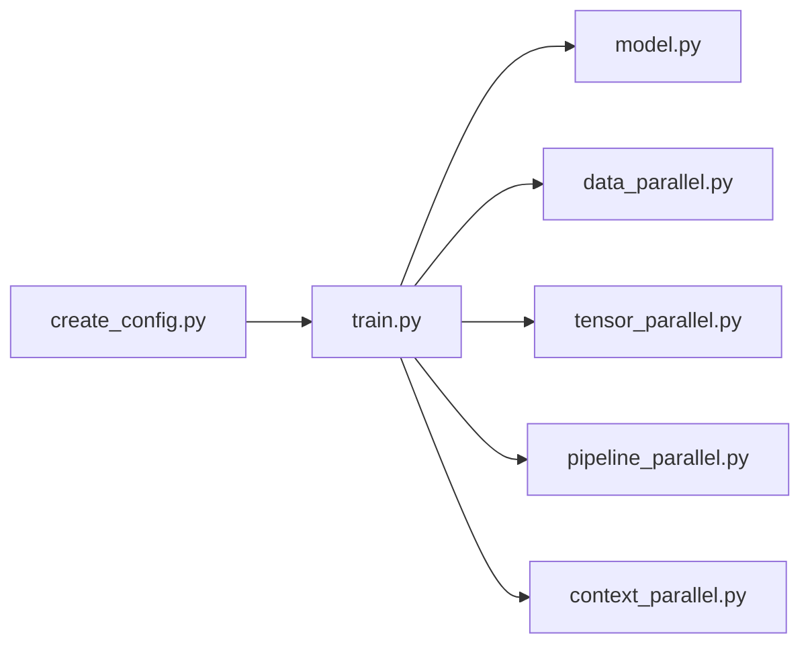

# huggingface/picotron

> Minimalist repository for learning Llama model pre-training with 4D parallelism.

## The problem
Distributed training frameworks are too big to understand how data, tensor, pipeline and context parallelism work.

## What it actually does
`train.py`, `model.py` and one file per parallelism (data, tensor, pipeline, context, each under 300 lines according to the README) form the core. `create_config.py` generates a JSON, `torchrun` launches the training, `submit_slurm_jobs.py` submits to Slurm. A `process_group_manager.py` manages the communication groups. The README reports 38% MFU on LLaMA-2-7B with 64 H100s.

## How it is wired


## Trying it
```bash
pip install -e .
python create_config.py --out_dir tmp --exp_name llama-1B --dp 8 --model_name HuggingFaceTB/SmolLM-1.7B --num_hidden_layers 15 --grad_acc_steps 32 --mbs 4 --seq_len 1024 --hf_token <HF_TOKEN>
torchrun --nproc_per_node 8 train.py --config tmp/llama-1B/config.json
```

## Cost and gotchas
GPU (up to several H100s for real tests) and a Hugging Face token. CPU mode possible but slow. Last push in August 2025.

## What it is not
Not a production tool: performance "is not the best", benchmarks "will come".

## Alternatives
The README cites Nanotron for fuller usage.

## For you
Worth watching: excellent material for learning distributed parallelism, but inactive for over a year, so not a base to build on.
