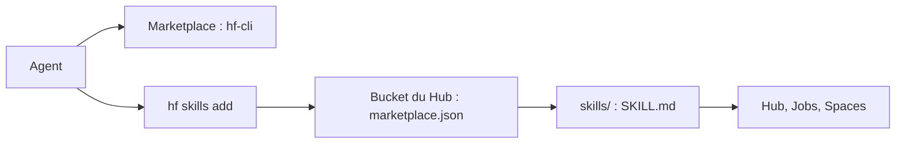

# huggingface/skills

> Agent skills for AI/ML tasks on the Hugging Face Hub: training, evaluation, datasets, Spaces.

## The problem
A coding agent knows neither the up-to-date `hf` commands nor the best practices for training, evaluation or deployment on the Hub and on SageMaker.

## What it actually does
An `hf-cli` skill, generated from the installed CLI, teaches the agent the Hub commands. The others are installed on demand with `hf skills add`: training (TRL, Unsloth, sentence-transformers, vision), evaluation (inspect-ai, lighteval), datasets, Gradio, Spaces and ZeroGPU, papers, memory estimation (`hf-mem`), local GGUF models, SageMaker deployment. The client marketplace deliberately exposes only `hf-cli`.

## How it is wired


## Trying it
```bash
/plugin marketplace add huggingface/skills
/plugin install hf-cli@huggingface/skills
hf skills add <skill-name>
gemini extensions install https://github.com/huggingface/skills.git --consent
```

## Cost and gotchas
The skills are free; GPU Jobs, dedicated Spaces and SageMaker are billed by their platform. A Hugging Face account is needed for most actions.

## What it is not
Not an ML library: these are instructions for the agent. The Claude marketplace installs only `hf-cli`; the rest goes through `hf skills add`.

## Alternatives
No alternative named in the README.

## For you
Adopt: if your work goes through the Hub, these publisher skills keep the agent from inventing commands; just check the costs of the Jobs you launch.
