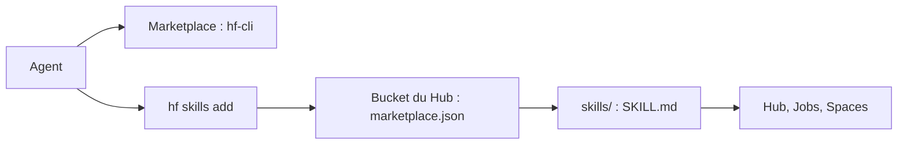

# huggingface/skills

> Skills d'agents pour les tâches IA/ML sur le Hub Hugging Face : entraînement, évaluation, datasets, Spaces.

## Le problème
Un agent de code ne connaît ni les commandes `hf` à jour ni les bonnes pratiques d'entraînement, d'évaluation ou de déploiement sur le Hub et sur SageMaker.

## Ce que ça fait vraiment
Un skill `hf-cli`, généré depuis le CLI installé, enseigne à l'agent les commandes du Hub. Les autres s'installent à la demande avec `hf skills add` : entraînement (TRL, Unsloth, sentence-transformers, vision), évaluation (inspect-ai, lighteval), datasets, Gradio, Spaces et ZeroGPU, papiers, estimation mémoire (`hf-mem`), modèles locaux GGUF, déploiement SageMaker. Le marketplace client n'expose volontairement que `hf-cli`.

## Comment c'est branché


## Essayer
```bash
/plugin marketplace add huggingface/skills
/plugin install hf-cli@huggingface/skills
hf skills add <skill-name>
gemini extensions install https://github.com/huggingface/skills.git --consent
```

## Coût et pièges
Les skills sont gratuits ; les Jobs sur GPU, Spaces dédiés et SageMaker sont facturés par leur plateforme. Un compte Hugging Face est nécessaire pour la plupart des actions.

## Ce que ce n'est pas
Pas une bibliothèque ML : ce sont des instructions pour l'agent. Le marketplace Claude n'installe que `hf-cli` ; le reste passe par `hf skills add`.

## Alternatives
Aucune alternative nommée dans le README.

## Pour toi
À adopter : si ton travail passe par le Hub, ces skills éditeur évitent à l'agent d'inventer des commandes ; vérifie seulement les coûts des Jobs lancés.

