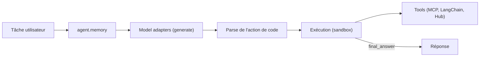

# huggingface/smolagents

> Python library for LLM agents whose actions are written as code, with sandboxed execution.

## The problem
Agents that call tools via JSON chain many steps, and wiring up the model, tools and execution yourself is laborious.

## What it actually does
CodeAgent works as a ReAct agent whose model writes its actions as Python snippets; ToolCallingAgent offers the classic JSON approach. The model is interchangeable (Inference providers, LiteLLM, OpenAI compatible, local transformers, Azure, Bedrock) and tools come from MCP, LangChain or Hub Spaces. The logic fits in under 1,000 lines (agents.py). Code runs locally or in E2B, Blaxel, Modal or Docker. Two commands: smolagent and webagent.

## How it is wired


## Trying it
```bash
pip install "smolagents[toolkit]"
smolagent "Plan a trip to Tokyo, Kyoto and Osaka between Mar 28 and Apr 7."  --model-type "InferenceClientModel" --model-id "Qwen/Qwen3-Next-80B-A3B-Thinking" --imports pandas numpy --tools web_search
```

## Cost and gotchas
Hosted model: the provider's token is at your expense, or a local model with a GPU. LocalPythonExecutor is not a security boundary: arbitrary code can run, so a sandbox is essential. The 30% reduction in steps is a figure from the README.

## What it is not
Not a ready-to-use agent: it is a library to assemble. Local mode does not isolate the generated code.

## Alternatives
No alternative cited in the README.

## For you
Adopt: a small, readable codebase for prototyping agents and understanding the ReAct loop, provided you run it in a sandbox.
