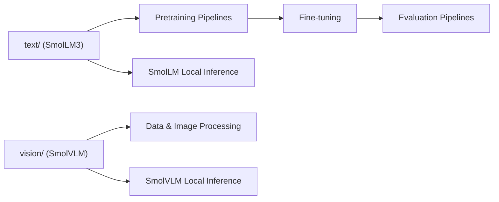

# huggingface/smollm

> A family of small open models (SmolLM3 for text, SmolVLM for vision) built to run on-device.

## The problem
High-performing compact models are often closed or poorly documented; we want open weights and an open training recipe, usable outside a server.

## What it actually does
SmolLM3 is a 3-billion-parameter model trained on 11 trillion tokens, with a dual reasoning mode (`think`/`no_think`), six languages including French, and a context of up to 128,000 tokens. SmolVLM handles images and text (visual questions, description). The repository contains the code for `text/`, `vision/` and `tools/` (local inference). The README states that SmolLM3 outperforms Llama 3.2 3B and Qwen2.5 3B, and competes with 4B models; these comparisons are the publisher's own.

## How it is wired

## Trying it
No shell command is documented in the README; it provides Python examples with `transformers` (`AutoModelForCausalLM.from_pretrained("HuggingFaceTB/SmolLM3-3B")`).

## Cost and gotchas
Free; the example picks `cuda` or `cpu` depending on the machine. The architecture description talks about SmolLM2 while the README highlights SmolLM3: follow the README. The example's generation allows up to 32,768 tokens.

## What it is not
It is not a model the size of the large LLMs: the gain is efficiency, not maximum performance. The repository is a directory of code and resources, not an application. The scores come from the publisher.

## Alternatives
- Qwen3: a competitor of similar size cited by the README.
- Gemma3: a 4B competitor cited in the same way.

## For you
Adopt for a compact open model, with French support and a public training recipe: useful for local prototyping or low-cost pre-sorting.
