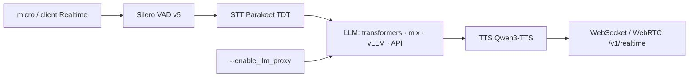

# huggingface/speech-to-speech

> Modular VAD→STT→LLM→TTS voice agent pipeline, exposed via the OpenAI Realtime protocol.

## The problem
Real-time voice APIs are closed and hosted: you cannot swap a link in the chain or keep the audio on your machine.

## What it actually does
Four cascaded components, each in its own thread, linked by queues: Silero VAD v5 for speech boundaries, STT (Parakeet TDT by default), LLM, then TTS (Qwen3-TTS by default). Each stage has several interchangeable backends chosen by CLI flags. The whole is exposed over WebSocket and WebRTC following the core event set of the OpenAI Realtime API. The LLM can run locally (transformers, mlx-lm), on your own vLLM or llama.cpp server, or at a provider. An optional LLM proxy exposes the upstream as a standard OpenAI endpoint for side tasks.

## How it is wired


## Trying it
```bash
python3 -m venv .venv
source .venv/bin/activate
pip install speech-to-speech
speech-to-speech local --mac-optimal-settings --model_name mlx-community/Qwen3-4B-Instruct-2507-4bit
speech-to-speech serve
speech-to-speech talk --url ws://127.0.0.1:8765/v1/realtime
docker compose up
```

## Cost and gotchas
Free when fully local, but it needs memory: ~16 GB unified on Apple Silicon, ~24 GB of VRAM on NVIDIA for the unquantized LLM, ~8 GB for the voice stack alone. The hosted LLM mode sends transcribed text, instructions and history to the provider (the audio stays local) and bills the calls. On Ubuntu: `libportaudio2`, `libsndfile1`, and a `qwentts-cpp-python` wheel matching your CUDA version. The LLM proxy has no authentication or rate limiting: trusted network or a gateway in front.

## What it is not
Not a complete implementation of the OpenAI Realtime API: the README speaks of a tested core subset, not equivalence. `serve` listens on `127.0.0.1` by default; you must deliberately pass `--host 0.0.0.0`. Deprecated implementations (MeloTTS) are in `archive/` and are no longer wired to the CLI.

## Alternatives
No competitor named; the README rather documents the interchangeable backends (vLLM, llama.cpp, HF Inference Providers, OpenRouter) and the OpenAI Agents SDK as a tested client.

## For you
The most serious building block for a fully local voice assistant; the four-stage architecture with replaceable stages is also worth studying as a design model.
