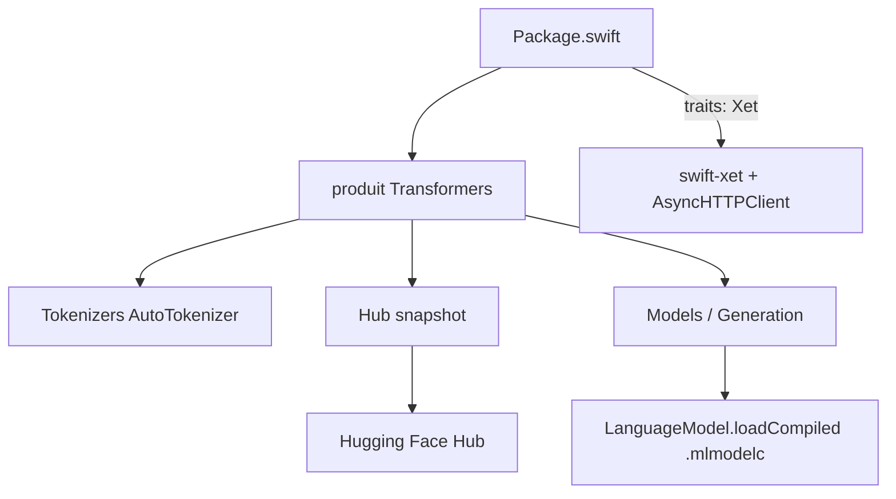

# huggingface/swift-transformers

> Swift library for tokenization, chat templates and downloading models from the Hub.

## The problem
Porting a language-model application to iOS or macOS means reimplementing tokenization and chat templates.
Downloading weights onto a device requires handling resumption, progress and unstable connections.

## What it actually does
`AutoTokenizer.from(pretrained:)` reproduces the familiar Python API, with `applyChatTemplate` and `decode`.
Natively handles tool-call formatting: you pass a function definition to `applyChatTemplate(messages:tools:)`.
`Hub.snapshot` downloads a repository filtered by pattern, with progress reporting and tolerance for flaky connections.
The `Models` and `Generation` modules serve CoreML; a local tokenizer can be injected into `LanguageModel.loadCompiled` for fully offline operation.

## How it is wired


## Trying it
```bash
huggingface-cli download \
  mistralai/Mistral-7B-Instruct-v0.3 \
  tokenizer.json tokenizer_config.json \
  --local-dir Examples/Mistral7B/local-tokenizer
swift build --traits Xet
swift test --traits Xet
```

## Cost and gotchas
The `Xet` trait, which enables parallel downloads, pulls in transitive dependencies and requires Swift 6.1+; below that, the default `URLSession` transport is used.
Xcode cannot declare a trait: the documented workaround is a local package that re-exports this one.
A gated repository requires `huggingface-cli login` beforehand.

## What it is not
Not an inference engine: generation goes through CoreML or MLX, not through this library alone.
Not a full equivalent of `transformers`: the most-used modules are `Tokenizers` and `Hub`.
Tokenizer files must come from the same repository as the checkpoint, otherwise results are silently wrong.

## Alternatives
- WhisperKit: Swift stack dedicated to transcription, if the need is speech rather than a general-purpose LLM.
- MLX Swift Examples: integrating MLX models into a Swift application.
- exporters: CoreML conversion of transformers models, upstream rather than a replacement.

## For you
Not relevant if you do not ship an Apple app; keep it in mind for the day a model has to run on an iPhone.
