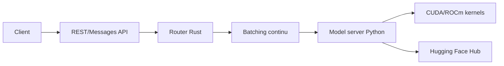

# huggingface/text-generation-inference

> Hugging Face LLM inference server (Rust/Python/gRPC), now archived in maintenance mode.

## The problem
Serving an LLM with continuous batching, streaming, quantisation and tensor parallelism requires a dedicated engine.

## What it actually does
Runs an HTTP server (`/generate_stream`, OpenAI-compatible Messages API) in front of a Hugging Face model.
Rust router + Python server, tensor parallelism via NCCL, quantisation (AWQ, GPTQ, bitsandbytes, fp8…).
OpenTelemetry tracing, OpenAPI docs at `/docs`, NVIDIA and AMD GPU support.
The README announces maintenance mode and recommends vLLM, SGLang, llama.cpp or MLX.

## How it is wired


## Trying it
```bash
model=HuggingFaceH4/zephyr-7b-beta
volume=$PWD/data
docker run --gpus all --shm-size 1g -p 8080:80 -v $volume:/data \
    ghcr.io/huggingface/text-generation-inference:3.3.5 --model-id $model
```

## Cost and gotchas
GPU and NVIDIA Container Toolkit required; `HF_TOKEN` for gated models. Repo archived: no further development.

## What it is not
No longer a choice for the future: only minor fixes were accepted before archiving. CPU is not a target.

## Alternatives
- vllm: recommended by HF as the successor for GPU production.
- SGLang: another recommended engine.
- llama.cpp / MLX: for local inference.

## For you
Ignore for a new project: archived, and HF itself points to vLLM or SGLang; keep it only to maintain an existing deployment.
