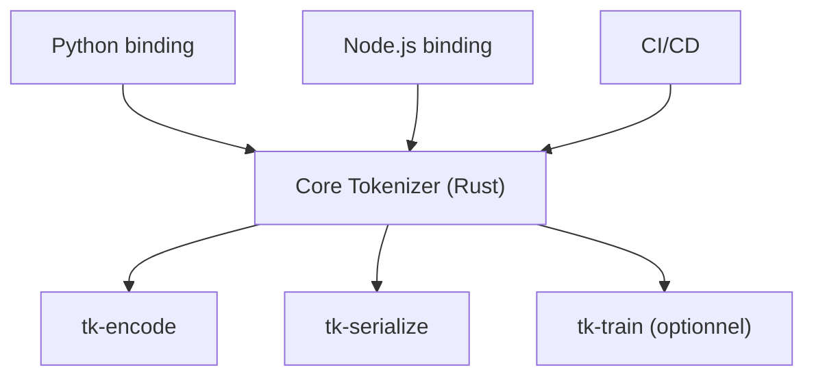

# huggingface/tokenizers

> Rust tokenization library with Python, Node.js and WebAssembly bindings, for language model engineers.

## The problem
Turning text into token IDs must be faithful to each model and fast in both training and serving.

## What it actually does
Loads a `tokenizer.json` (for example from the Hub), compiles it, then encodes and decodes. Covers BPE, Unigram, WordPiece, WordLevel. The core is split into crates: encoding, reading, conversion of old files, training (optional), bit-stream pre-tokenization. No SIMD required, the portable path is always present. v1.0.0 is a release candidate, with some features still to be reported.

## How it is wired


## Trying it
```bash
pip install --pre tokenizers
```
```python
from tokenizers import Tokenizer
tokenizer = Tokenizer.from_pretrained("meta-llama/Llama-3.1-8B")
compiled = tokenizer.compile()
compiled.encode("Hello, y'all! How are you ?")
```
On the Rust side: `tokenizers = "1.0.0"` in `Cargo.toml`.

## Cost and gotchas
Free. Release candidate: training, offsets and `tokenizer.save` are to be reported in Python. Training and Hub download are options in Rust.

## What it is not
Not a model nor a complete LLM training tool. The Ruby binding is external; C, C++, Java and Go are only planned.

## Alternatives
None named in the README.

## For you
Adopt: a standard building block of any NLP/LLM pipeline; only watch for v1 breaking changes before migrating.
