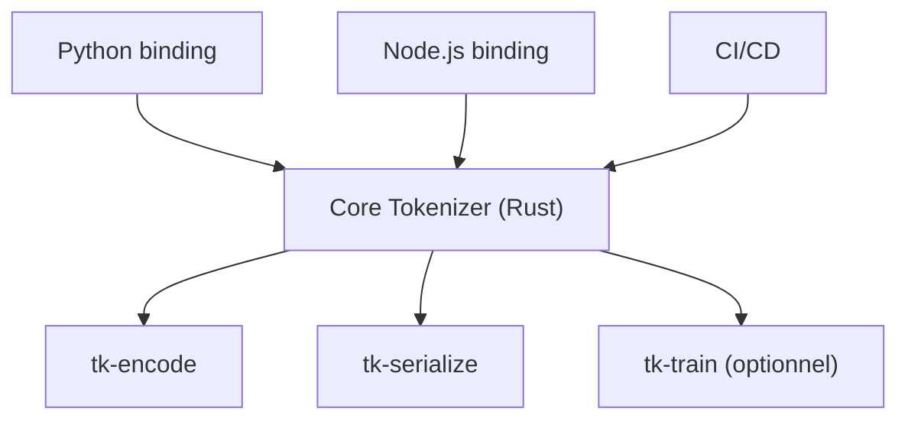

# huggingface/tokenizers

> Bibliothèque de tokenisation en Rust avec liaisons Python, Node.js et WebAssembly, pour ingénieurs de modèles de langage.

## Le problème
Transformer du texte en identifiants de tokens doit être fidèle à chaque modèle et rapide en entraînement comme en service.

## Ce que ça fait vraiment
Charge un `tokenizer.json` (par exemple depuis le Hub), le compile, puis encode et décode. Couvre BPE, Unigram, WordPiece, WordLevel. Le cœur est découpé en crates : encodage, lecture, conversion des anciens fichiers, entraînement (optionnel), pré-tokenisation en flux de bits. Aucun SIMD requis, chemin portable toujours présent. La v1.0.0 est en release candidate, avec des fonctions encore à rapporter.

## Comment c'est branché


## Essayer
```bash
pip install --pre tokenizers
```
```python
from tokenizers import Tokenizer
tokenizer = Tokenizer.from_pretrained("meta-llama/Llama-3.1-8B")
compiled = tokenizer.compile()
compiled.encode("Hello, y'all! How are you ?")
```
Côté Rust : `tokenizers = "1.0.0"` dans `Cargo.toml`.

## Coût et pièges
Gratuit. Version candidate : l'entraînement, les offsets et `tokenizer.save` sont à rapporter en Python. Entraînement et téléchargement du Hub sont des options en Rust.

## Ce que ce n'est pas
Pas un modèle ni un outil d'entraînement complet de LLM. Le binding Ruby est externe ; C, C++, Java et Go sont seulement planifiés.

## Alternatives
Aucune nommée dans le README.

## Pour toi
Adopter : brique standard de tout pipeline NLP/LLM ; surveiller seulement les ruptures de la v1 avant de migrer.

