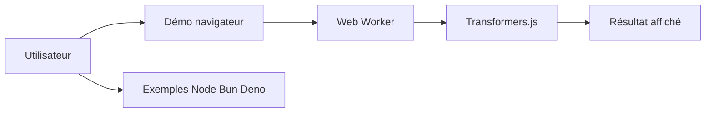

# huggingface/transformers.js-examples

> Collection of Transformers.js demos, from the WebGPU browser to Node, Bun, Deno and web frameworks.

## The problem
Knowing how to integrate model inference into a web page or a JS runtime without a Python server.

## What it actually does
A table of independent projects: WebGPU LLM chats (Phi-3.5, Llama-3.2, SmolLM), Segment Anything segmentation, background removal, PGlite semantic search, embeddings with Bun and Deno, sentiment analysis with Node, Next.js and SvelteKit. From the code: no common runtime, each example is self-contained.

## How it is wired

## Trying it
No command documented in the README; each example is a subfolder, with a demo link and a starter template on Hugging Face.

## Cost and gotchas
Free. WebGPU required for the LLM demos; models are downloaded in the browser.

## What it is not
Not a library: examples to copy. Last push in February 2026.

## Alternatives
No alternative named in the README.

## For you
Adopt as a reference for client-side AI: published by Hugging Face, Apache-2.0, demos ready to fork.
