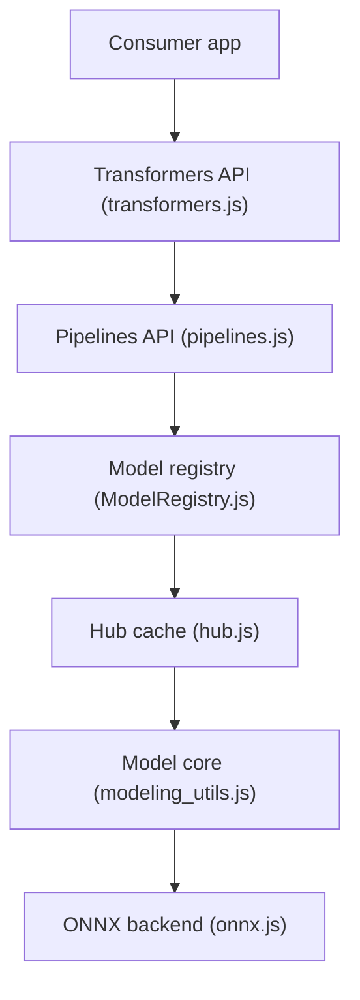

# huggingface/transformers.js

> Runs Hugging Face models directly in the browser or Node, with no server, via ONNX Runtime.

## The problem
Running inference (text, image, audio) client-side without hosting a Python server or sending the data elsewhere.

## What it actually does
Reuses the `pipeline` API of the Python `transformers` library for many NLP, vision, audio and multimodal tasks. Inference goes through ONNX Runtime: CPU in WASM by default, WebGPU optionally, with quantization (`q8`, `q4`). Models come from the Hugging Face Hub, with a local cache and configurable paths. PyTorch models can be converted to ONNX with Optimum.

## How it is wired


## Trying it
```bash
npm i @huggingface/transformers
```
```javascript
import { pipeline } from '@huggingface/transformers';
const pipe = await pipeline('sentiment-analysis');
const out = await pipe('I love transformers!');
```

## Cost and gotchas
Free. The first load downloads the model and WASM binaries (bandwidth). WebGPU is still experimental in many browsers.

## What it is not
Not a full equivalent of the Python version: some tasks are marked unsupported (tabular, image generation, visual question answering). Large models remain limited by the browser.

## Alternatives
The Python `transformers` library, whose API it copies, remains preferable server-side.

## For you
Adopt: the obvious choice for demos or local in-browser AI features, with respect for privacy.
