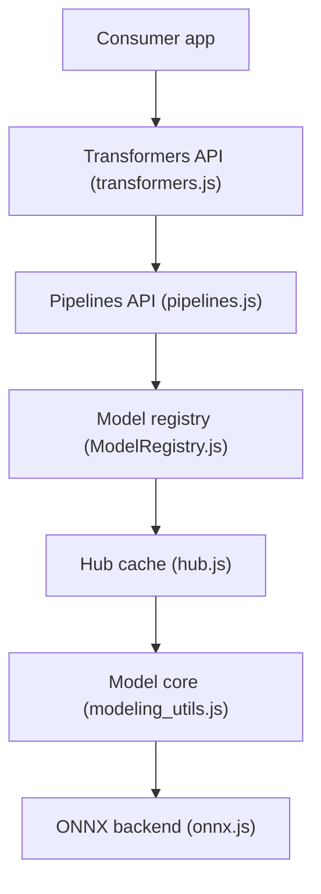

# huggingface/transformers.js

> Exécute des modèles Hugging Face directement dans le navigateur ou Node, sans serveur, via ONNX Runtime.

## Le problème
Faire de l'inférence (texte, image, audio) côté client sans héberger un serveur Python ni envoyer les données ailleurs.

## Ce que ça fait vraiment
Reprend l'API `pipeline` de la bibliothèque Python `transformers` pour de nombreuses tâches NLP, vision, audio et multimodales. L'inférence passe par ONNX Runtime : CPU en WASM par défaut, WebGPU en option, avec quantification (`q8`, `q4`). Les modèles viennent du Hub Hugging Face, avec cache local et chemins configurables. Les modèles PyTorch se convertissent en ONNX avec Optimum.

## Comment c'est branché


## Essayer
```bash
npm i @huggingface/transformers
```
```javascript
import { pipeline } from '@huggingface/transformers';
const pipe = await pipeline('sentiment-analysis');
const out = await pipe('I love transformers!');
```

## Coût et pièges
Gratuit. Le premier chargement télécharge modèle et binaires WASM (bande passante). WebGPU est encore expérimental dans de nombreux navigateurs.

## Ce que ce n'est pas
Pas équivalent complet à la version Python : certaines tâches sont marquées non supportées (tabulaire, génération d'images, question visuelle). Les gros modèles restent limités par le navigateur.

## Alternatives
La bibliothèque Python `transformers`, dont elle copie l'API, reste préférable côté serveur.

## Pour toi
À adopter : choix évident pour des démos ou des fonctions IA locales dans le navigateur, avec respect de la vie privée.

