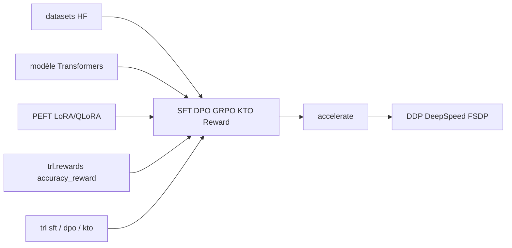

# huggingface/trl

> Post-training library for foundation models: SFT, DPO, GRPO, KTO, reward models.

## The problem
Aligning a model after pre-training requires implementing subtle RL loops that are easy to get wrong.
And each published method arrives with its own throwaway code, incompatible with the Transformers ecosystem.

## What it actually does
Exposes one trainer per method: `SFTTrainer`, `DPOTrainer`, `GRPOTrainer`, `KTOTrainer`, `RewardTrainer`.
Each trainer is a thin wrapper around the Transformers Trainer, with DDP, DeepSpeed ZeRO and FSDP.
Relies on Accelerate to scale from one GPU to a multi-node cluster, and on PEFT for LoRA/QLoRA.
A CLI lets you launch `trl sft`, `trl dpo`, `trl kto` without writing code.

## How it is wired


## Trying it
```bash
pip install trl
trl sft --model_name_or_path Qwen/Qwen2.5-0.5B --dataset_name trl-lib/Capybara --output_dir Qwen2.5-0.5B-SFT
```
Development version: `pip install git+https://github.com/huggingface/trl.git`, then `pip install -e .[dev]`.

## Cost and gotchas
Post-training requires a GPU, with more memory the larger the model; PEFT and
quantization are the way out on modest hardware. The long-context guide goes up to an 8-GPU node.

## What it is not
Not an evaluation framework: it trains, it does not measure the quality of what it produces.
Not pre-training: the announced scope is post-training.
`trl.experimental` commits to nothing: everything there changes or disappears from one version to the next without notice.

## Alternatives
`Unsloth` — integrated, to speed up training through optimized kernels.
`PEFT` — if you only want LoRA without TRL's trainer layer.

## For you
The reference if you need to fine-tune or align a model: start with `SFTTrainer` on a 0.5B before you believe in it.
