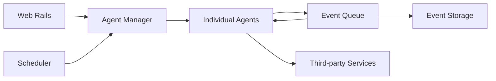

# huginn/huginn

> Self-hosted agent system that monitors the web and triggers actions, a DIY version of IFTTT or Zapier.

## The problem
Online automation tools store your data with a third party and limit the possible scenarios.

## What it actually does
Agents create and consume events propagated along a graph: reading websites, RSS, IMAP, webhooks, MQTT; sending emails or messages (Slack, Telegram, Twilio…); calling compatible OpenAI APIs; logic in JavaScript, Liquid, or jq. Web Rails with background worker, MySQL or PostgreSQL.

## How it is wired


## Trying it
```bash
docker run -it -p 3000:3000 ghcr.io/huginn/huginn
```

## Cost and gotchas
Free of charge; you are responsible for providing accommodation, a base, and a worker (no free tiers on the platforms mentioned). The administrator password is displayed only once in the container's log.

## What it is not
Not a data pipeline orchestrator or an MLOps tool.

## Alternatives
No alternative is mentioned in the README (IFTTT and Zapier are cited as examples).

## For you
Things to watch out for: useful for monitoring or self-hosted alerts, but for data/MLOps, a dedicated orchestrator is a better solution.
