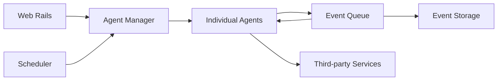

# huginn/huginn

> Système d'agents auto-hébergé qui surveille le web et déclenche des actions, version bricolable d'IFTTT ou Zapier.

## Le problème
Les outils d'automatisation en ligne gardent tes données chez un tiers et plafonnent les scénarios possibles.

## Ce que ça fait vraiment
Des agents créent et consomment des événements propagés le long d'un graphe : lecture de sites, RSS, IMAP, webhooks, MQTT ; envoi de mails ou de messages (Slack, Telegram, Twilio…) ; appels à des API compatibles OpenAI ; logique en JavaScript, Liquid ou jq. Web Rails plus worker en tâche de fond, MySQL ou PostgreSQL.

## Comment c'est branché


## Essayer
```bash
docker run -it -p 3000:3000 ghcr.io/huginn/huginn
```

## Coût et pièges
Gratuit ; hébergement, base et worker toujours actifs à ta charge (pas de palier gratuit sur les plateformes citées). Mot de passe admin affiché une seule fois dans le journal du conteneur.

## Ce que ce n'est pas
Pas un orchestrateur de pipelines de données ni un outil MLOps.

## Alternatives
Aucune alternative nommée dans le README (IFTTT et Zapier sont cités comme références).

## Pour toi
À surveiller : utile pour de la veille ou des alertes auto-hébergées, mais pour du data/MLOps un orchestrateur dédié convient mieux.

