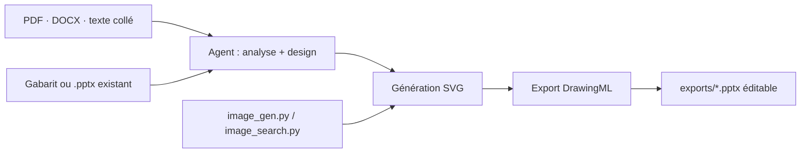

# hugohe3/ppt-master

> A skill that generates a native, editable `.pptx` file from a source document.

## The problem
AI-powered slide generators produce flattened images or a pseudo-PowerPoint format: it's impossible to retrieve individual elements within the actual PowerPoint software.

## What it actually does
A workflow that runs on any agent capable of reading, writing, and executing: you say "create a presentation from this PDF," and it exports a `.pptx`. It aims to use the native object model of PowerPoint – shapes and connectors with adjustment handles, data-backed charts and tables, a text/image/fill/effects model, and layouts (`p:sldMaster`/`p:sldLayout`). Other options include: creating a template from a reference, populating an existing `.pptx` while preserving the design, adding transitions, animations, and narration. Formulas are compiled into editable OMML.

## How it is wired


## Trying it
```bash
git clone https://github.com/hugohe3/ppt-master.git && cd ppt-master
pip install -r requirements.txt
npx skills add hugohe3/ppt-master
python3 skills/ppt-master/scripts/image_gen.py --list-backends
```

## Cost and gotchas
Python 3.10+. The only cost is your model usage, but it is real: the README recommends a large-context model (~1M tokens) and image generation (`gpt-image-2` or `gemini-3.1-flash-image`). Pexels/Pixabay API keys are optional. The optional PDF converter depends on PyMuPDF, which is licensed under **AGPL-3.0**, not MIT: this should be verified before any redistribution.

## What it is not
The README clearly states: don't expect a perfect deck right away; the template sets the limits, and the finishing touches are up to you. SmartArt is intentionally omitted. The README highlights several sponsors who are API access resellers.

## Alternatives
- cc-switch: switching between API providers (Claude Code, Codex, and Gemini CLI).
- microsoft/ResearchStudio: From paper to video, posters, and blogs.

## For you
Things to watch out for: Compare it seriously with your existing deck before switching channels.
