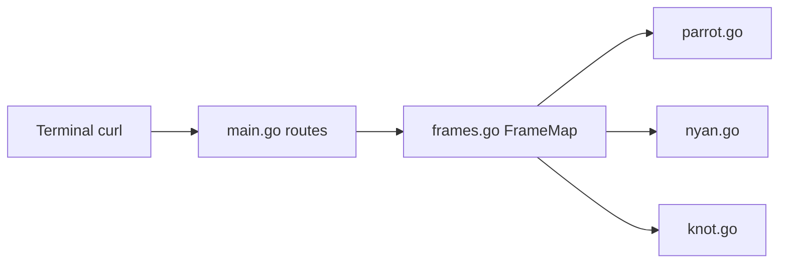

# hugomd/ascii-live

> Go server that streams looping ASCII animations to `curl`, successor of parrot.live.

## The problem
Showing animations in a terminal without installing anything.

## What it actually does
An HTTP server in Go routes a request to an animation, checks that it exists and that the client is curl, then streams the frames in a loop until disconnection. `/list` gives the names. Each animation is a contributed Go file in `frames/`.

## How it is wired


## Trying it
```bash
curl ascii.live/parrot
go run main.go
docker run -p 8080:8080 hugomd/ascii-live:latest
```

## Cost and gotchas
Free. 72 open issues, last push in May 2025.

## What it is not
Entertainment, not a work tool.

## Alternatives
parrot.live, its predecessor, and terminal-parrot, cited in the README.

## For you
Ignore: a curiosity with no use for data, AI or MLOps.
