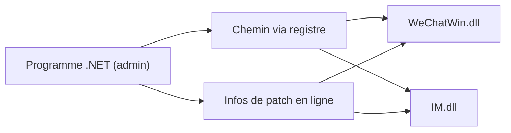

# huiyadanli/RevokeMsgPatcher

> Windows patch that prevents WeChat, QQ and TIM from deleting messages recalled by the other party.

## The problem
On PC, WeChat/QQ/TIM make a message disappear when the sender recalls it. This patch aims to keep the text readable.

## What it actually does
Modifies `WeChatWin.dll` (WeChat) or `IM.dll` (QQ/TIM) on disk, using byte signatures that the author does not look for himself ("simple transport of characteristics"). Detects the installation folder via the registry. The README adds a WeChat multi-instance tool. The QQNT and WeChat 4 versions reuse signatures from other projects.

## How it is wired


## Trying it
No command documented: usage is graphical. Steps from the README:
```bash
# 1. Fermer WeChat/QQ/TIM
# 2. Lancer le programme en administrateur (Windows 7+, .NET Framework 4.5.2+)
# 3. Choisir le dossier d'installation, puis cliquer « 防撤回 »
```

## Cost and gotchas
Free, Windows only. The patch must be reapplied after every application update. Antivirus software may raise alerts because DLLs are modified.

## What it is not
Not a tool for macOS or Linux, nor for mobile. It applies only to specific versions, listed in the external documentation. No guarantee of compatibility after an update.

## Alternatives
- wechat_anti_revoke: project from which the initial content derives.
- BetterWX: source of the WeChat 4 signatures.
- NTQQAntiRecall: source of the QQNT 2.1 signatures.

## For you
Ignore: a Chinese consumer messaging tool, modifying closed binaries, unrelated to data/AI/MLOps work.
