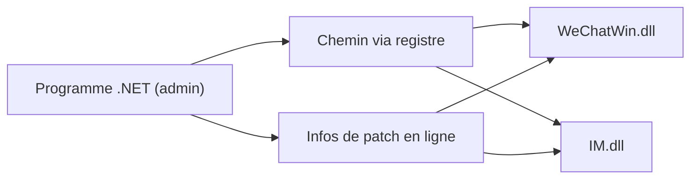

# huiyadanli/RevokeMsgPatcher

> Patch Windows qui empêche WeChat, QQ et TIM de supprimer les messages rétractés par l'interlocuteur.

## Le problème
Sur PC, WeChat/QQ/TIM font disparaître un message que l'expéditeur rétracte. Ce patch veut garder le texte lisible.

## Ce que ça fait vraiment
Modifie `WeChatWin.dll` (WeChat) ou `IM.dll` (QQ/TIM) sur le disque, avec des signatures d'octets que l'auteur ne cherche pas lui-même (« simple transport de caractéristiques »). Détecte le dossier d'installation via le registre. Le README ajoute un outil de multi-instance WeChat. Les versions QQNT et WeChat 4 reprennent des signatures d'autres projets.

## Comment c'est branché


## Essayer
Aucune commande documentée : l'usage est graphique. Étapes du README :
```bash
# 1. Fermer WeChat/QQ/TIM
# 2. Lancer le programme en administrateur (Windows 7+, .NET Framework 4.5.2+)
# 3. Choisir le dossier d'installation, puis cliquer « 防撤回 »
```

## Coût et pièges
Gratuit, Windows uniquement. Le patch est à refaire après chaque mise à jour de l'application. Les antivirus peuvent alerter car des DLL sont modifiées.

## Ce que ce n'est pas
Pas un outil pour macOS ou Linux, ni pour mobile. Il ne s'applique qu'à des versions précises, listées dans la documentation externe. Aucune garantie de compatibilité après mise à jour.

## Alternatives
- wechat_anti_revoke : projet dont le contenu initial est issu.
- BetterWX : source des signatures WeChat 4.
- NTQQAntiRecall : source des signatures QQNT 2.1.

## Pour toi
Ignorer : outil de messagerie grand public chinois, modifiant des binaires fermés, sans lien avec un travail data/IA/MLOps.

